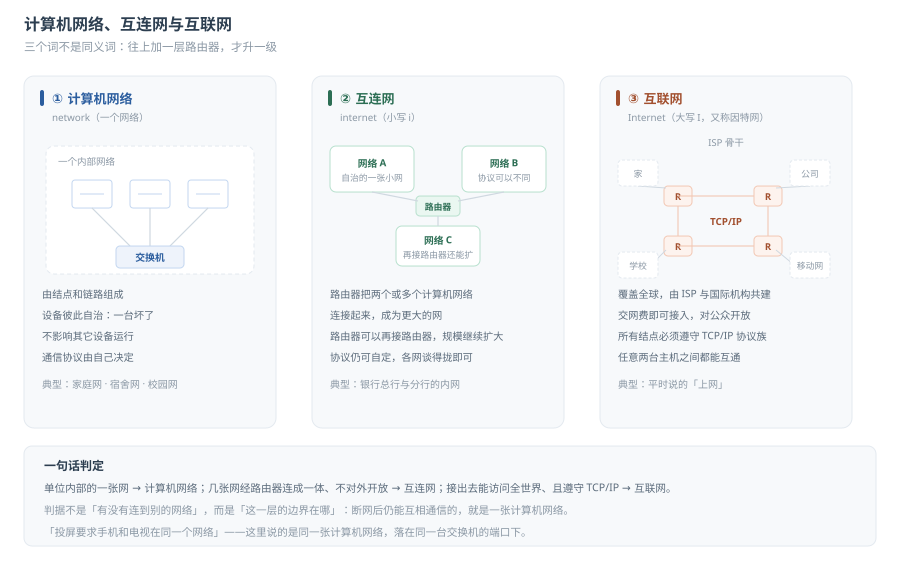
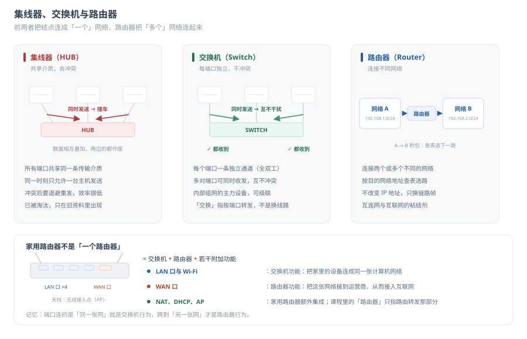
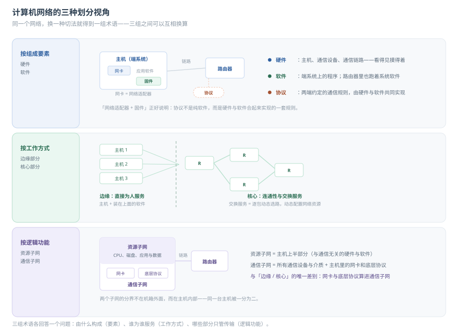
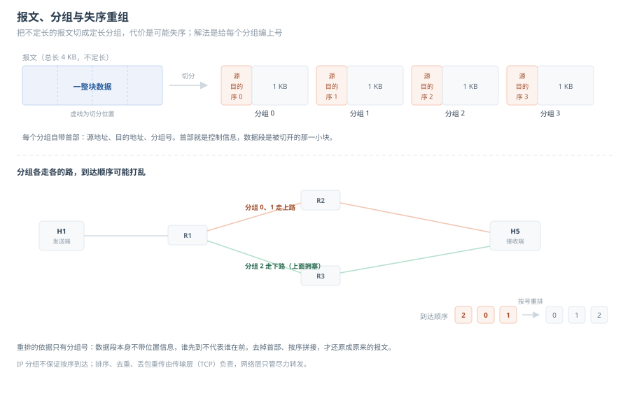
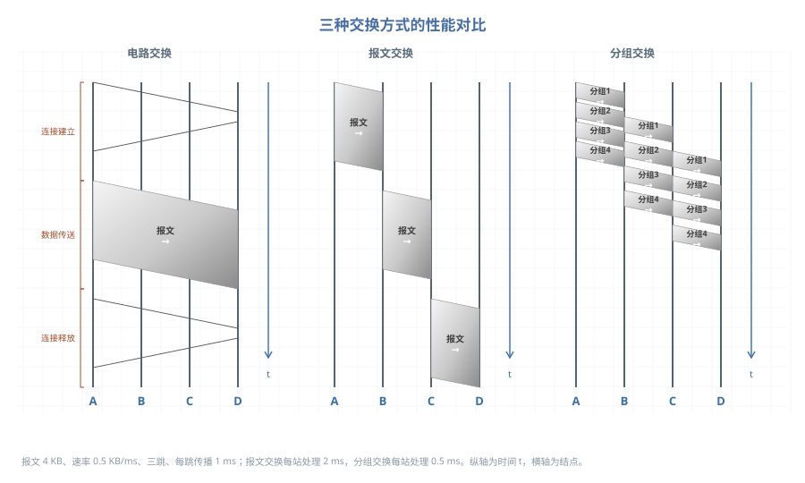

## 计算机网络概述

这一篇是计算机网络的开头：先把术语的边界划清，再逐层向下展开。第一次学觉得概念模糊是正常的——它们会在后续各章反复出现、逐步加深，学完整门课回头再看，本章反而是最容易的一章。

> **发送数据的一生**：应用进程产生报文 → 传输层加端口封装成报文段/数据报（端到端可靠/流量/拥塞控制）→ 网络层加 IP 地址封装成数据报（路由、最长前缀匹配转发）→ 数据链路层加 MAC 地址封装成帧（成帧、差错控制、介质访问控制）→ 物理层编码调制为比特流/信号逐段传播；接收方逐层解封装，逆过程上交。
>
> **地址体系**：MAC 地址（链路内，永久）→ IP 地址（网络间，可变、逻辑定位）→ 端口号（进程定位）；**ARP** 打通 IP↔MAC，**DNS** 打通域名↔IP，**DHCP** 动态分配 IP，**NAT** 打通私网↔公网。
>
> **一句话记忆各层**：物理层——"传比特"；数据链路层——"传帧，管相邻节点"；网络层——"选路，管主机到主机"；传输层——"管进程到进程，保证可靠"；应用层——"为用户服务"。

### 什么是计算机网络

#### 定义与构成要素

计算机网络技术是**通信技术与计算机技术相结合**的产物。

计算机网络是将不同地理位置的、具有独立功能（**自治**）的多个计算机系统，通过各种**通信设备和线路**连接起来，在**网络协议和软件的支持**下进行数据通信，实现**信息交换和资源共享**的系统。

定义里每个定语都有用，少一个就不成立：

- **分散**：设备分布在不同地点，不是一台机器内部的多个部件。
- **自治**：每台设备都能独立运行，一台关机或故障不影响其他设备——这是「计算机网络」与「主从终端系统」的分界。
- **通信设备与线路**：路由器、交换机、集线器、5G 基站是设备；网线、光纤、Wi-Fi 是线路。
- **协议与软件**：光有线路不通，双方还要按同一套规则说话；规则由协议规定、由软硬件共同实现。
- **目的**：资源共享与信息传递。前者指硬件、软件、数据，后者就是数据通信。

> 判断一段描述算不算「计算机网络」，先看**自治**：一台主机带若干不能独立工作的哑终端（如早期分时系统的终端），只是主机的外设延伸，不构成网络。

> **日常场景**：我们每天都会使用计算机网络，使用不同类型的设备去连接计算机网络，比如手机、笔记本电脑或者台式机，现在还有智能手表、智能电视，这些都可以连接计算机网络。不同的设备，连接计算机网络的方式也各不相同：笔记本电脑可以通过 Wi-Fi 连接路由器从而接入计算机网络；台式机可以通过网线连接路由器从而接入网络；在户外使用手机，则是通过 5G 通信技术连接 5G 基站从而接入计算机网络。在这些设备中我们会安装一些方便易用的软件，比如说百度网盘或微信，可以用百度网盘去共享资源等——这些功能都离不开计算机网络的支撑。

从组成结构看，计算机网络由若干**结点**和连接这些结点的**链路**组成：

- **结点**：可以是计算机、集线器、交换机、路由器等。
- **链路**：可以是有线链路（网线、光纤）、无线链路（Wi-Fi、蜂窝网络）。

两台电脑用一根网线直连，就是最小的一张计算机网络——两个结点、一条链路；四台电脑各拉一根网线接到同一台集线器上，是五个结点、四条链路。

**考察形式**：综合知识选择题。

#### 计算机网络、互连网与互联网

三个术语中文读音相近，英文只差首字母大小写，含义却分属三个层次：

| 术语 | 英文 | 由什么连成 | 协议 | 典型 |
| --- | --- | --- | --- | --- |
| 计算机网络 | network | 结点 + 链路 | 自定 | 家庭网、宿舍网、校园网、银行分行内网 |
| 互连网 | internet（小写 i） | 路由器连接两个或多个计算机网络 | 自定，各网谈得拢即可 | 银行总行与各分行组成的内网 |
| 互联网 | Internet（大写 I），又称因特网 | 全球的互连网经 ISP 与国际机构连成一体 | 必须使用 TCP/IP 协议族 | 日常说的「上网」 |

> 图 1.1：三个术语的层次——同样的设备，往上加一层路由器就升一级，协议要求也随之收紧

**互连网**（internet，连接的「连」）：由路由器把两个或多个计算机网络连接起来的网络，也称「网络的网络」。路由器还可以再接路由器，规模随之扩大。它不要求全球覆盖，也不要求对外开放——一个机构自建的内部网络，只要由多个子网经路由器互联，就是互连网。

银行的例子最典型：一家银行有总行和四家分行，每家分行各自是一张独立的计算机网络，分行之间、分行与总行数据中心之间由路由器互联。客户在 A 分行存 1000 元，这笔记录经路由器逐层上报到总行数据中心；下次在 D 分行取钱，也能从数据中心查到余额。这张网不对家庭宽带开放，但它是标准的互连网。

**互联网**（Internet，相互的「互」）：覆盖全世界范围的互连网，由 ISP（互联网服务提供商，如中国电信、中国移动、中国联通）与国际机构共同建设，对公众开放——交网费即可接入。中文语境里的「互联网」通常特指 Internet，也就是因特网。

判断四句话：

- 「家里宽带欠费，断网了」——**互联网**。断的是与运营商之间的连接；家里的局域网还在，手机投屏照样能用。
- 「要不要一起去上网」——**互联网**。说的是接入 Internet。
- 「投屏要求手机和电视连同一个网络」——**计算机网络**。两者接在同一台交换机的端口下，属于同一张局域网。
- 「回银行登录内网才能办业务」——**互连网**；如果只是一个网点内部的网，则是**计算机网络**。判据是「跨没跨路由器」。

**协议上的差别**：全球互联网要求所有结点遵守同一套规则，即 TCP/IP 协议族；而自建的互连网内部，各网之间谈得拢即可，用什么协议由自己决定。类比秦统一后的「书同文」：统一之前，秦国的人只能给秦国的人写信，因为文字不同；统一之后，咸阳与邯郸才能按同一套规则通信。协议就是网络世界的文字。

**接入路径**：开通宽带时，师傅把一根网线接到你家路由器上，另一头最终接到运营商的商用路由器。实际中间还要经过接入网的多级设备（光纤到户、楼道交换机、城域网），示意图画成一条线只是为了讲清层次。

**考察形式**：综合知识选择题。

### 组网设备：集线器、交换机与路由器

把结点连成一张网、把几张网连成互连网，靠的是三类设备。它们的分工也是后面各章的伏笔：集线器在物理层、交换机在数据链路层、路由器在网络层。

#### 三种设备的分工

- **集线器（HUB）**：多端口的中继器，工作在物理层。所有端口共享同一条传输介质、同处一个冲突域，同一时刻只允许一台主机发送；两台同时发送，信号叠加，双方数据都作废，只能退避重发。半双工、效率低，已被淘汰。
- **交换机（Switch）**：工作在数据链路层，按 MAC 地址转发。每个端口一条独立通道，支持全双工，多对端口可同时通信，不存在集线器那种冲突；可以级联，是现在组建内部网络的主力设备。
- **路由器（Router）**：工作在网络层，连接两个或多个**不同**的网络，按目的网络地址查表选择下一跳。它不改变 IP 地址，只把分组重新封装到下一段链路的帧里。

> 图 1.2：三种设备的分工——前两者把结点连成「一个」网络，路由器把「多个」网络连起来

一句话分工：**端口连的是同一张网，就是交换机行为；跨到另一张网，才是路由器行为。**

> [!WARNING]
> **警告内容**：教材里的「路由器」只指路由转发那部分功能，不等于家里的无线路由器。两者混淆，后面学路由表、转发流程时会处处别扭。

**考察形式**：综合知识选择题。

#### 家用路由器：交换机与路由器的合体

家用路由器是多种设备的集合，至少在逻辑上包含三部分：

| 部分 | 对应功能 | 说明 |
| --- | --- | --- |
| LAN 口 / Wi-Fi | 交换机功能 | 把电视、电脑、手机接进同一张局域网，彼此可直接通信 |
| WAN 口 | 路由器功能 | 把这张局域网接到运营商，从而接入互联网 |
| NAT、DHCP、无线 AP、防火墙 | 附加功能 | 家用场景的集成，教材不展开 |

这解释了两件日常事：

- **投屏的前提**是手机与电视处在同一张计算机网络里。它们接在家用路由器的交换机部分，处在同一广播域内，才能互相发现。
- **「断网」断的是 WAN 侧**：宽带欠费后路由器仍在工作，家里设备之间的通信不受影响。

**考察形式**：综合知识选择题。

### 计算机网络的组成

同一个网络可以从三个角度切：按**组成要素**切成硬件、软件与协议；按**工作方式**切成边缘与核心；按**逻辑功能**切成资源子网与通信子网。三组术语说的是同一批设备，只是切法不同。

> 图 1.3：三种视角对照——三组术语各回答一个问题：由什么构成、谁为谁服务、哪些部分只管传输

#### 按组成部分

按组成要素划分，计算机网络由硬件、软件与协议三部分构成。硬件是看得见摸得着的部分，软件是跑在上面的程序，协议是双方必须遵守的规则——三者缺一，网络都转不起来。

- **硬件**：主机、通信设备、通信链路。
  - **主机（端系统，end system）**：接入网络的计算机类设备。称「端」是因为它位于网络的末端：用户直接操作的是它，网络只负责把数据送到，不关心它内部在算什么。
  - **通信设备**：把端系统接入网络、并在网络内部转发数据的设备，如路由器、交换机、集线器、调制解调器。
  - **通信链路**：连接结点的线路，如双绞线、同轴电缆、光纤，以及无线链路。
- **软件**：实现网络功能的程序。端系统上是浏览器、聊天软件、播放器这类应用；路由器本身也是一台微型计算机，里面同样跑着系统软件，只不过功能集中在转发与路由。
- **协议**：规定通信双方「怎么开口、说什么、什么时候说」的规则，由硬件与软件共同实现。

**协议为什么不是纯软件**：主机里的**网络适配器**（俗称网卡）出厂时，厂家在板上的 ROM 里烧了**固件**——一种特殊的软件。网卡硬件负责收发信号，固件负责按协议组帧、校验，两者合起来才实现某一层协议。Windows 下可在「控制面板 → 网络和共享中心 → 更改适配器设置」中右键属性，看到网卡型号与它支持的协议（如 TCP/IPv4）；无线网卡同理。

**考察形式**：综合知识选择题。

#### 按工作方式

按工作方式划分，计算机网络分为直接服务用户的边缘部分与提供交换的核心部分。

- **边缘部分**：直接为用户服务（数据通信、资源共享），由连接到互联网上的主机及其软件组成。
- **核心部分**：为边缘部分提供服务（**连通性、交换服务**），由大量网络与连接这些网络的路由器组成。

**连通性**：边缘的主机之间彼此可达，A 能给 B 发数据。

**交换服务**：分组从 A 到 B 往往有多条路径，核心部分要为每个分组动态选一条合适的路——哪条路径负载轻就走哪条，避免某条链路被压垮。这本质上是对网络内部资源的动态配置与调整。实现交换服务的核心设备是路由器。

举例：A 电脑要给 B 手机发一个分组，就近的路由器后面有两条路径可走。下游某台路由器负载很高时，分组改走另一条——选哪条不看距离远近，看当时的网络状态。

**考察形式**：综合知识选择题。

#### 按逻辑功能

按逻辑功能划分，计算机网络可拆为提供资源的资源子网与负责传输的通信子网。

- **资源子网**：向用户提供硬件、软件和信息资源的共享，主要由连接到互联网上的主机组成。
- **通信子网**：负责数据传输和交换。所有的通信设备和通信介质都属于通信子网，网络适配器这类硬件以及一些底层的网络协议，也是为了实现计算机之间的信息传输。

这套划分与「边缘 / 核心」几乎重合：核心部分整体落在通信子网里。唯一的差别在主机内部——网卡与底层协议虽然装在主机里，但干的是传输的活，要划归通信子网。所以两个子网的分界不在机箱外面，而在主机内部，同一台主机被一分为二。

**考察形式**：综合知识选择题。

### 计算机网络的功能

计算机网络的功能可归为五项，其中**数据通信**是前提——它不成立，其余四项都无从谈起。

- **数据通信**：在主机之间传送数据，是最基本、最重要的功能。定义里的「信息交换」指的就是它。
- **资源共享**：共享硬件（云端算力、打印设备）、软件（应用商店分发的程序）与数据（文件、音视频）。智能音箱把语音送到云端算力处理，就是硬件资源共享的典型；应用商店下载程序是软件共享；发一段自己拍的视频是数据共享。
- **分布式处理**：把一个大任务拆成若干子任务交给多台主机并行处理，用网络把分散的算力拼成一台「大机器」。矩阵乘法就能这样拆：A 的前 5 行乘 B，得到 C 的前 5 行，交给一台主机；第 6～10 行交给另一台，最后拼起来。Hadoop、MapReduce、渲染农场都是这个思路。
- **提高可靠性**：同一份资源或服务放在多个节点上，单点故障时由其他节点接替。网盘把一份文件在 A、B 两台服务器上各存一份，A 坏了还能从 B 取回——所以重要文件存在网盘上，往往比只存自己一块硬盘更稳。
- **负载均衡**：把请求分摊到多台服务器或链路（如 CDN、四层负载均衡），避免单点过载。网络游戏常把「匹配」和「对战」拆开：匹配服只负责凑局，凑好的一局交给当前空闲的对战服，几百万玩家才不至于挤在一台上。

> 五项功能的层次：数据通信是底座；资源共享、分布式处理是「用网络办事」；提高可靠性与负载均衡是「让网络本身更稳」。

**考察形式**：综合知识选择题。

### 计算机网络的分类

#### 按覆盖范围

**局域网（LAN）**：覆盖小范围，如办公室、校园、单位、部门。

**广域网（WAN）**：覆盖大范围，如城市、国家或全球。

**城域网（MAN）**：介于局域网和广域网之间，覆盖城市区域。

- **覆盖范围**：**局域网（LAN）**小范围，如家庭、办公室、校园；**广域网（WAN）**大范围，如城市、国家甚至全球。
- **传输速度**：**局域网（LAN）**高速（一般为 100 Mbps ~ 10 Gbps 及以上）；**广域网（WAN）**较慢（一般为几十 Mbps 到 Gbps）。
- **延迟**：**局域网（LAN）**低延迟，适合高实时性需求；**广域网（WAN）**高延迟，尤其在跨国通信中更明显。
- **传输介质**：**局域网（LAN）**双绞线、电缆、光纤、Wi-Fi 等；**广域网（WAN）**光纤、电缆、卫星通信、蜂窝网络等。
- **网络结构**：**局域网（LAN）**常为星形、总线、环形拓扑；**广域网（WAN）**采用路由器和交换机构建的复杂网络，通常使用网状拓扑。
- **应用场景**：**局域网（LAN）**办公楼、学校、家庭网络、数据中心等；**广域网（WAN）**互联网、跨国公司网络、云服务等。
- **典型协议**：**局域网（LAN）**以太网（Ethernet）、Wi-Fi；**广域网（WAN）**MPLS、PPP、BGP、IP。
- **安全性**：**局域网（LAN）**较高，通常只限内部访问；**广域网（WAN）**安全性较低，需要 VPN 或防火墙保护。
- **数据交换技术**：**局域网（LAN）**共享广播；**广域网（WAN）**存储转发。

**考察形式**：综合知识选择题。

#### 按拓扑结构

**总线拓扑（Bus Topology）**：所有设备共享一条主干线路，通过分支连接到主干上。布线简单、成本低，但**总线故障会导致整个网络失效**；设备增多时容易出现通信冲突，影响性能；负载能力有限、**实时性差**、存在**总线争用问题**，采用**广播式传输**。

**环形拓扑（Ring Topology）**：每个设备与相邻的两个设备连接，形成一个闭合的环路。数据以单一方向传输，减少冲突；但任意一个节点故障会导致整个网络中断，网络扩展不灵活。使用**令牌**解决总线争用问题——只有持有令牌者可以发送消息，采用**广播式传输**。

**星形拓扑（Star Topology）**：所有设备通过独立的线路连接到一个中央节点（如交换机或路由器）。单个设备故障不会影响整个网络；但**依赖中央节点**，若其故障则网络瘫痪；布线成本高，需要大量电缆；采用**点对点传输**。这是目前家庭和企业局域网最常用的拓扑。

**网状拓扑（Mesh Topology）**：每个设备与网络中的多个设备直接相连。即使某条连接失效，也不会影响通信；但布线复杂且成本高；采用**点对点传输**，**常见于广域网**。

> **树形拓扑（Tree Topology）**：由多个星形拓扑通过总线连接组成，形成类似树的层次结构。易于扩展，适合层级结构的网络（如学校、企业网络）；高层节点的故障可能影响下层所有节点；网络复杂性增加时维护难度加大。

**考察形式**：综合知识选择题。

#### 按传输媒介

1. **有线网络**：通过物理介质进行数据传输，常见的介质有：
   - **双绞线**：成本低，使用最广（网线）。
   - **同轴电缆**：抗干扰能力较好（有线电视网络）。
   - **光纤**：使用光信号传输，适用于高速、大规模数据传输。优点：**传输速度快、距离远、不受电磁干扰、难以窃听**。
2. **无线网络（Wireless Network）**：通过无线电波、红外线等媒介进行数据传输（Wi-Fi、蓝牙、蜂窝网络）。

**考察形式**：综合知识选择题。

#### 按功能

按服务对象划分，计算机网络可归为面向公众的互联网与组织自建的私有网络。

- **互联网**（全球最大的公共网络，由多个异构网络互联而成）：优点：全球互联、资源丰富、开放性高；缺点：安全性低，容易受到攻击。
- **私有网络**（由一个组织或机构独立构建和维护，仅供内部使用的网络）：优点：控制权强、安全性高、性能稳定；缺点：需要专门人员维护，扩展和管理成本高。

**考察形式**：综合知识选择题。

#### 按传输技术

按信道的使用方式划分，计算机网络分为广播式网络与点对点网络。

- **广播式网络**（所有节点共享同一条通信信道，数据包发送后会被所有设备接收，但只有目标节点处理）：优点：网络结构简单，易于实现组播和广播通信；缺点：带宽共享，容易产生冲突和拥塞。
- **点对点网络**（每一对通信设备之间通过独立的通信链路进行数据传输，不共享传输介质）：优点：通信效率高，适合远距离、高速传输；缺点：成本高，需要大量通信链路。

**考察形式**：综合知识选择题。

### 性能指标

**信道**：表示向某一方向传送信息的通道。一条通信线路在逻辑上往往对应一条发送信道和一条接收信道（**信道 ≠ 通信线路**）。

#### 速率、带宽、吞吐量

三个指标都以 bps 为单位，分别描述传输快慢、链路上限与实际数据量。

- **速率**：也称数据传输速率，表示每秒钟传输的比特数，单位为 **bps（bits per second）**。速率通常用于衡量链路的传输能力，如 100 Mbps、1 Gbps 等（**1 B = 8 b**）。
- **带宽**：表示通信链路所能提供的**最高数据传输能力**，单位同样为 bps。带宽决定了链路理论上的最大传输速率。上行带宽指上传速率，下行带宽指下载速率。
- **吞吐量**：实际传输的数据量，通常受限于网络拥塞、协议开销和硬件性能，单位为 bps。吞吐量反映系统的实际性能。

> 通俗理解：带宽是"高速公路的最高限速"，速率是"实际跑的速度"，吞吐量是"单位时间内真正运过去的货物量"。

**考察形式**：综合知识选择题。

#### 时延、时延带宽积、往返时延

时延、时延带宽积与往返时延从三个角度刻画数据在链路上的时间开销。

- **时延**：数据从发送端到达接收端所需的时间，单位为毫秒（ms），包括**发送时延、传播时延、处理时延、排队时延**四部分。
- **时延带宽积**：表示网络中同时存在的数据量，为 **带宽 × 时延**，用于衡量链路的"填充"程度。
- **往返时延（RTT）**：数据从发送端发送完，到接收端再返回发送端所需的时间，单位为 ms。**RTT 是 TCP 等协议中重要的性能指标**。

时延的四个组成部分：

- **发送时延（传输时延）**：节点把数据推向信道所花的时间，= 数据长度 ÷ 发送速率。
- **传播时延**：电磁波在信道中传播一定距离所花的时间，= 信道长度 ÷ 电磁波传播速率（铜线/光纤中约 2×10⁸ m/s，接近光速）。
- **处理时延**：被路由器处理所花的时间（如分析首部、查找转发表）。
- **排队时延**：数据排队进入、排队发出路由器所花的时间，随负载增大呈非线性急剧增长。

> **总时延 = 发送时延 + 传播时延 + 处理时延 + 排队时延**。注意：提高链路速率只能减小**发送时延**，不能减小**传播时延**——这也是"网络很快但跨洋访问依然卡"的原因之一。

**考察形式**：综合知识选择题。

#### 信道利用率

表示信道中实际用于传输数据的时间与总可用时间的比值。信道利用率越高，说明链路资源的使用越有效；但**过高的信道利用率可能导致网络拥塞和延迟增大**。

**考察形式**：综合知识选择题。

### 互联网的构成与接入网

#### 三大组成部分

从构成角度看，互联网由网络边缘、网络核心与接入网三部分组成。

- **网络边缘**：位于互联网边缘、与互联网相连的计算机和其他设备（端系统），如桌面计算机、移动设备、服务器、智能终端等。
- **网络核心**：由互联端系统的**分组交换设备**和**通信链路**构成的网状网络，包括路由器、链路层交换机，以及光纤、铜缆、无线电、卫星链路等。
- **接入网**：将主机连接到**边缘路由器**（端系统去往任何远程端系统路径上的第一台路由器）的物理链路，是异构网络接入互联网的桥梁。

**考察形式**：综合知识选择题。

#### 常见接入网方式（对照日常使用）

接入网把端系统接到边缘路由器，常见方式可按介质与部署场景逐一对照。

- **光纤到户（FTTH）**（从运营商端局直接铺设光纤到用户家中）：速率高、抗干扰，是当前家庭宽带主流方式（即"光猫 + 光纤"）。
- **数字用户线（DSL/ADSL）**（利用电话线上未被语音使用的频带传输数据，上下行速率不对称）：早期的"电话线上网"，现基本被光纤取代。
- **同轴电缆（HFC）**（利用有线电视网络，上下行共享带宽）：广电宽带使用。
- **无线接入**（Wi-Fi（无线局域网）、4G/5G 蜂窝移动网络等）：手机上网、公共场所 Wi-Fi。
- **企业与家庭网络**（局域网 + 路由器 + NAT 共享接入）：一台路由器让全家设备共用一个公网 IP。

**考察形式**：综合知识选择题。

### 三种数据交换方式

三种技术各有出身：电路交换为电话而生，报文交换为电报而生，分组交换为计算机而生。

20 世纪 60 年代阿帕网立项，要解决的是把分散在全国各地的主机连起来。当时可抄的作业只有两份——电话网与电报网。先试电路交换，发现不适合计算机的突发流量；再试报文交换，方向对了，但报文不定长带来一堆麻烦；把报文切成定长的小块，才得到分组交换。**分组交换不是凭空设计的，是报文交换的定长化改良**。

#### 电路交换

电路交换为通信双方建立一条**专用的物理通路**：通信前建立，通信中独占，通信后释放。**电话网络**是它的典型代表。

原理并不复杂。早期的电话交换机是一块插孔面板，每个插孔背后连着一部电话，也可能连着另一台交换机；要让两部电话通话，话务员用一根线把对应的两个插孔连起来。所谓电路交换，就是**通过物理线路的连接，动态地为用户分配传输线路资源**。后来人工接线改为电气化、自动化，过程没变，只是不再需要话务员。

一次通话分三步：

1. **建立连接**：主叫拨号，沿途各交换机逐段接通线路，被叫振铃；被叫摘机应答，主叫确认连接建立。
2. **通信**：双方独占这条通路，中途不释放。
3. **释放连接**：挂机后逐段拆除，线路资源归还。

两个日常现象由此而来：

- **占线**：小红和小美通话时占用了中间某段线路，第三个人再拨小美，前面几跳还能分配，最后一跳已经占满，只能听到「您呼叫的用户正在通话中」。
- **长途比本地贵**：本地通话经过一台交换机，长途要经过三台，占用的线路资源更多，资费自然更高。

优缺点：

- **优：传输快、时延稳定**。线路已经接通，数据直通，中间节点不做存储转发。
- **优：按序到达**。通路唯一，不存在失序。
- **缺：建立与释放有开销**。等 2 分钟、通话 5 秒，体验极差；反过来通话 1 小时，这 2 分钟可以忽略。所以它适合**低频次、大批量**的持续通信。
- **缺：不适应突发流量**。计算机通信是高频次、小批量：聊微信时打字花很久，发送只一瞬间。为每条消息建一次连接，开销远大于传输本身。
- **缺：线路利用率低**。一条通路在一段时间内只能被一对用户占用，成本高。
- **缺：灵活性差**。中途某个节点或线路故障，只能重新建立连接，不能动态改路。
- **缺：中间节点不做差错控制**。数据原样通过，链路上哪一段出错都无人发现；经过的链路越多，出错概率越大。

**考察形式**：综合知识选择题。

#### 报文交换

报文交换**不建立连接**，把整条消息作为一个**报文**交给网络，由中间节点逐站存储、查表、转发。**电报网络**是它的典型代表。

**报文的结构**：控制信息 + 用户数据。控制信息指明从哪来、到哪去，相当于信封；用户数据是要传的内容。计算机网络把 message 译作「报文」，指的就是这个整体。

节点的处理固定为三步：

1. **存储**：报文先收进节点的内存，收完整再处理。
2. **查表**：读控制信息，查**存储转发表**，确定下一跳。
3. **转发**：从对应端口发往下一站，逐站重复，直到目的节点。

转发表里往往有多条可选路径，走哪条看当时负载——下面空闲走下面，上面空闲走上面。中途某条线路坏了，换一条即可，不必重建连接。

优缺点：

- **优：无需建立连接**，把报文交给网络即可。
- **优：线路共享，利用率高**。同一条链路可以同时承载多对用户的报文，不再被一对用户独占；某段链路故障还能改道，可靠性随之提高。
- **优：转发路径灵活**，可按负载改道，也能绕开故障。
- **优：支持差错控制**。节点既然把报文收进了内存，就可以用奇偶校验等手段检查、甚至纠正错误，长距离传输更可靠。
- **缺：报文不定长，管理困难**。短则几个字节，长则几个 GB；要存下一部 8 GB 的电影，节点就得有 8 GB 内存，报文更大还得继续扩。
- **缺：缓存开销大**，内存管理复杂。定长分区好管，大小不一只能分片管理。
- **缺：处理时间长**。报文越长，校验越慢，存储转发时延越大。
- **缺：时延大且波动，不适合实时业务**。每站都要收完整报文再转发，跳数越多累积越久；报文越长，等待越久。
- **缺：长报文更容易出错，重传代价也高**。一个比特出错整包作废，校验纠不过来，就得让发送方重发整个报文。

> 报文交换的缺点几乎都指向同一个根源：**报文不定长**。改掉这一条，其余问题大半自解——这正是分组交换的出发点。

**考察形式**：综合知识选择题。

#### 分组交换

分组交换是报文交换的改良版：**把不定长的报文切成定长的分组**，其余机制照搬。**现代计算机网络**用的就是它。

报文交换的优点——无需建连、共享链路、路径灵活、支持差错控制——分组交换全部继承，只把存储转发的单位从报文换成了分组。

**分组（packet）= 首部 + 数据**。首部装控制信息：

- **源地址、目的地址**：网络据此判断从哪来、往哪去。路由器按 IP 地址转发。
- **分组号**：接收方据此排序重组。一张图片被切成多个分组、走不同路径到达，顺序可能打乱，没有编号就拼不回去。

节点仍是存储转发，但单位从报文变成分组，报文交换的几个缺点同时被削平：

- **定长，便于管理**：内存按统一大小分配，调度简单。
- **小，缓存与处理开销低**：1 KB 的分组比 4 KB 的报文处理快得多。
- **出错概率低**：数据越短，途中被干扰的比特越少。
- **重传代价小**：丢一个分组只重发这一块，不必重发整条报文。

代价是三点：

- **控制信息占比升高**：每个分组都要带一份首部，而一个报文只带一份；不过增加幅度有限，换来定长管理与更小的重传代价，总体划算。
- **仍有存储转发时延**：比电路交换慢，每个节点都要收完、查表、再发。
- **可能失序、丢失**：不同分组走不同路径，到达顺序不定，也可能中途丢失；排序、重传、去重的复杂度都压在接收端。

失序的例子：分组 0、1 走上面那条路，分组 2 因上面拥塞改走下面，先到达目的主机，接收顺序成了 2、0、1；目的主机按首部的分组号排回 0、1、2，去掉首部再拼成原数据。现代网络里承担分组交换的典型设备是**路由器**，它按 IP 地址判断去向。

> 图 1.4：报文切分与失序重组——教材用「分组号」讲排序原理；实际 IP 首部只有分片重组的标识字段，端到端的排序由传输层序号完成

**考察形式**：综合知识选择题。

#### 虚电路交换

虚电路交换本质仍是分组交换，只是借了电路交换的一个动作：**先建立连接，再传数据，最后释放**。

与电路交换的区别在于：建立的是一条**虚电路**，不是专用物理通路。分组沿途仍要存储转发，链路仍可被其他用户共享，不独占。

好处是分组沿统一路径、按序到达，接收端不必排序。既然如此，为什么现代互联网不用它？

- 虚电路把「不乱序、不丢失」的责任交给网络核心：核心节点要维护每条虚电路的状态，还要保证顺序与可靠，转发负担重、吞吐下降。
- 分组交换把这份责任推给端系统：核心只管尽力转发，主机算力强，排序、重传、去重都由传输层完成。

结论：**核心越简单，网络越快**。这是互联网选择无连接分组交换的根本原因。虚电路也并非没有应用，ATM、帧中继、X.25 的网络层都提供面向连接的虚电路服务，只是没有成为主流。

**考察形式**：综合知识选择题。

#### 三种交换方式对比

电路交换、报文交换与分组交换的差别，可从连接、资源、时延与可靠性几个维度比较。

- **是否建立连接**：**电路交换**先建立专用物理路径（建立 → 通信 → 释放三阶段）；**报文交换**不建立连接；**分组交换**不建立连接。
- **资源占用**：**电路交换**独占链路带宽（FDM/TDM 复用）；**报文交换**存储转发，资源共享；**分组交换**存储转发，统计复用。
- **时延特点**：**电路交换**建立连接有开销，传输阶段时延稳定；**报文交换**报文不定长，时延大且波动；**分组交换**分组小，时延相对小。
- **差错控制**：**电路交换**中间节点不检查，数据原样通过；**报文交换**与**分组交换**的节点先存储再转发，可用校验手段查错、纠错。
- **可靠性/灵活性**：**电路交换**差（线路故障即中断），资源浪费；**报文交换**较好；**分组交换**好，灵活，健壮。
- **典型应用**：**电路交换**传统电话网络；**报文交换**电报系统；**分组交换**现代互联网。
- **适用业务**：**电路交换**长报文、实时话音等持续通信；**报文交换**非实时的长消息；**分组交换**突发性数据，覆盖绝大多数互联网业务。

- **分组交换的缺点**：存在存储转发时延、排队时延，可能拥塞、丢包、失序、重复。
- **分组交换的优点**：设计简单、资源利用率高、适合突发流量，代价是「尽力而为（best-effort）」服务。
- **传输时延估算**：设报文总长 x bit、分组长度 p bit（含首部）、链路数（跳数）为 h、每段链路速率 R（忽略传播时延），分组交换总时延 ≈ x/R + (h−1)·p/R（首个分组沿途逐站存储转发，后续分组流水线并行）。

**考察形式**：综合知识选择题。

#### 时延对比：同一组假设下的三种交换

先学会看这类时间图。它是网络课的标准画法，后面各章反复出现：

- **纵轴是时间**，向下递增，一个小格代表 1 ms。
- **竖线是结点**，A、B、C、D 四根线对应四台设备；横向间距只表示相邻关系，不代表地理距离。
- **斜线是传播**：箭头从一根竖线指向下一根，纵向跨 1 格，表示一跳 1 ms 的传播时延。
- **斜带是发送**：粗斜带的纵向厚度，是把整块数据推上线路所需的时间（发送时延）；带越厚，数据越长或速率越低。
- **斜带的坡度**在本例中是 1 格/跳，因为传播时延只由距离与介质决定，与数据量无关；换一组参数，坡度会变，但同一条链路上的所有比特坡度一致。

同一组参数：报文 4 KB、发送速率 0.5 KB/ms（发完需 8 ms），链路 A—B—C—D 三跳、每跳传播 1 ms；报文交换每站处理 2 ms，分组交换每站处理 0.5 ms。

> 图 1.5：三种交换方式的时间图——左侧为建立、传送、释放三阶段，斜带厚度是发送时延，坡度是传播时延

逐段推演：

- **电路交换**：建链阶段 A→B 1 ms、B 内部接通 1 ms、B→C 1 ms、C 内部接通 1 ms、C→D 1 ms、D 处理 2 ms，应答沿原路返回 3 ms，合计 10 ms 才能开始发数据。数据阶段 8 ms 发送 + 3 ms 传播 = 11 ms。
- **报文交换**：A 发完 8 ms，首比特再走 1 ms 到 B，B 收齐在第 9 ms；处理 2 ms 后转发，B→C、C→D 同理。三段各 9 ms，加两次处理 4 ms，共 31 ms。
- **分组交换**：1 KB 一组，发送 2 ms。首组 2+1+0.5+2+1+0.5+2+1 = 10 ms；此后每 2.5 ms 到一组（2 ms 发送 + 0.5 ms 处理），三组再添 7.5 ms，共 17.5 ms。

| 方式 | 时延构成 | 端到端合计 |
| --- | --- | --- |
| 电路交换 | 发送 8 ms ＋ 传播 3 ms，中途不存储转发 | 11 ms（建立、释放另计） |
| 报文交换 | 三段各「发送 8 ＋ 传播 1」，B、C 两站各处理 2 ms | 31 ms |
| 分组交换 | 首组 2＋1＋0.5＋2＋1＋0.5＋2＋1 = 10 ms，其后每 2.5 ms 到一组 | 17.5 ms |

三条结论：

- **只算数据阶段，电路交换最快**：线路直通，没有逐站存储转发，8 ms 发完再加 3 ms 传播就到齐。
- **报文交换最慢**：每站必须收完整包才能转发，三段完全串行；报文越长、跳数越多，劣势越明显。
- **分组交换靠流水线扳回一局**：首组仍要逐站走完，但后续分组边收边转，端到端只比电路交换多 6.5 ms，却换来了链路共享。

> 反过来看：本例建立连接约需 10 ms，若把建立与释放计入，电路交换总计约 21 ms，短报文场景反而最慢。这就是「电路交换适合长报文与持续通信，分组交换适合突发、短报文」的定量依据。

> 关于 29 ms：课件按格子数得 29 ms，与按「每站 2 ms 处理、每跳 1 ms 传播」逐段相加的 31 ms 差 2 ms，差在两处处理与传播边界的对齐。考试按题目给定条件逐段相加，不必记 29 这个数。

**考察形式**：综合知识选择题。

### 标准化工作及相关组织

计算机网络的发展离不开标准化工作，主要组织包括：

- **ISO（国际标准化组织）**：制定了 OSI 七层参考模型等标准。
- **IEEE（电气与电子工程师协会）**：制定局域网标准，如 IEEE 802.3（以太网）、802.11（Wi-Fi）、802.1Q（VLAN 标签）。
- **ITU（国际电信联盟）**：制定电信领域标准（如 X.25、帧中继、H.323）。
- **IETF（互联网工程任务组）**：负责 TCP/IP 协议族的标准制定，以 RFC 文档发布（如 RFC 793 定义 TCP）。
- **ICANN / IANA**：管理全球域名系统和 IP 地址分配。
- **W3C（万维网联盟）**：制定 Web 标准（HTML、CSS 等）。
