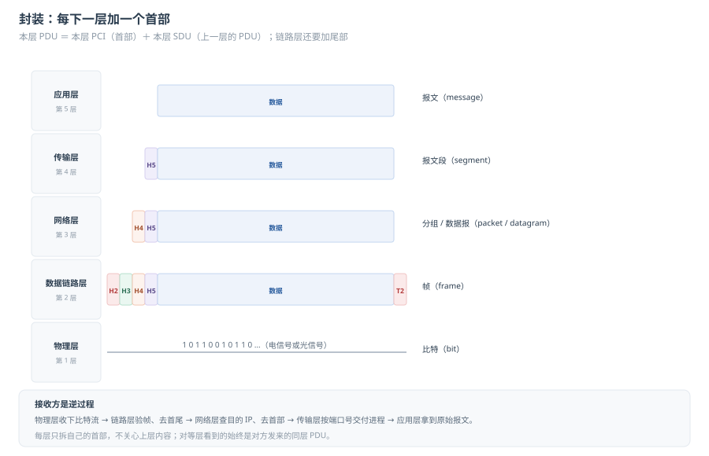
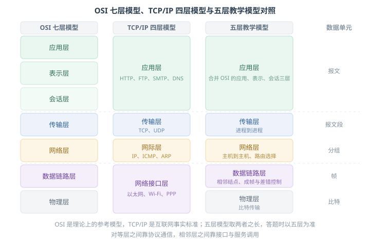

## 计算机网络体系结构

网络要完成的事情太多：差错控制、流量控制、分段重装、复用分用、连接管理……把这些功能堆在一起，既说不清也实现不了。**分层**就是把这堆问题拆成若干局部问题，每层只管一摊。这一篇讲清四组问题：为什么分层、层与层怎么配合、分成哪几种、几种模型差在哪。

### 分层设计思想

#### 快递网络：四层怎么分

先看一个不涉及网络的例子。一个快递网络要干这些活：货物打包、上门取派件、冷链存储、规划转运路径、干线运输。现实中的快递公司把它拆成四层：

| 层次 | 角色 | 承担的功能 |
| --- | --- | --- |
| 第 4 层 | 顾客 | 货物打包 |
| 第 3 层 | 快递员 | 取件、派件 |
| 第 2 层 | 仓储部门 | 冷链存储、决定下一站（路由） |
| 第 1 层 | 运输部门 | 汽车、火车、飞机运输 |

每个快递终点站都具备这四层；路上的**中转站**只具备下两层——它不需要快递员和顾客，只要仓储与运输。

包裹的流转就是逐层请求下层服务：

1. 顾客把货打包好，请求快递员上门取件。
2. 快递员取到件，交给仓储部门入库；仓储部门按目的地决定下一站，委托运输部门发运。
3. 运输部门把包裹送到下一个中转站；中转站入库、仓储部门再次决定下一站、再交给运输部门。
4. 到终点站后反向交付：运输 → 仓储 → 快递员 → 顾客。

三个结论值得记住：

- **分层不唯一**。在顾客与快递员之间加一层快递驿站，就变成五层，照样能跑。
- **功能要放在合适的层**。让卡车司机去派件，就是分配不合理；计算机网络里让物理层去做路由，同样是错位。
- **同一个功能可以在多层重复出现**。打包可以由顾客做，也可以由驿站做，都合理；网络里差错控制在链路层、网络层、传输层都出现，各有各的范围。

**考察形式**：综合知识选择题。

#### 分层解决了什么问题

把上面的例子抽象一下，分层带来三样东西：

- **复杂问题局部化**。一层只面对本层的问题，不必同时操心上下层的细节。
- **边界稳定，内部可独立演进**。只要层间接口不变，换一种实现方式不影响其他层——光纤替代铜线，上层协议不用改。
- **便于分工、实现与标准化**。不同厂商各做一层，按同一套接口对接。

计算机网络的分层与快递网络同构：主机是终点站，要实现全部层次；路由器是中转站，只实现下三层；网线光纤是运输线路，算第 0 层。

**考察形式**：综合知识选择题。

### 网络体系结构

#### 定义：只说做什么，不规定怎么做

**网络体系结构**是计算机网络**各层及其协议的集合**，是对网络及其构件**所应完成功能的精确定义**。

定义里只包含三样东西：分几层、每层实现哪些功能、每个功能由什么协议实现。**不涉及实现**——用哪种芯片、哪种语言、哪种算法，是厂商的事。

> 体系结构是**抽象**的，实现是**具体**的。按同一份体系结构，不同厂商可以造出互通的设备，前提是各自遵守同一套协议。

**考察形式**：综合知识选择题。

#### 实体、协议、接口与服务

这四个词是理解分层的关键，分属两个方向：

- **实体（entity）**：第 N 层的**活动元素**，即工作在该层的软件模块或硬件模块。主机、路由器在每个层次上各有一个实体。
- **对等实体**：不同节点中处于**同一层**的实体。左边主机的传输层实体与右边主机的传输层实体，就是对等实体。
- **协议（protocol）**：控制**对等实体**之间通信的规则集合，约束的是**水平**方向。对等层之间只有按同一协议说话，才能配合完成本层功能。
- **服务（service）**：下层通过**接口**向上层提供的功能调用，约束的是**垂直**方向。接口也叫**服务访问点（SAP）**。

> 只有**相邻**两层才有服务与被服务的关系：第 N 层用第 N−1 层的服务，向第 N+1 层提供服务。上层只能看见接口，看不见下层怎么实现——像调用一个函数，只管传参和取返回值。

服务可以按不同维度分类：可靠与不可靠、有连接与无连接、有应答与无应答。初学阶段不必展开，后面学到具体协议时自然会对照。

**协议三要素**——写一个协议，必须把这三样规定清楚：

| 要素 | 规定什么 | 例子 |
| --- | --- | --- |
| **语法** | 数据与控制信息的**格式** | 首部几个字节、每个字节什么含义、数据部分最长多少 |
| **语义** | 需要发出何种控制信息、完成何种动作、做出何种应答 | 发完数据后对方是否应答、应答有哪几种（成功/失败） |
| **同步（时序）** | 执行操作的**条件与先后顺序** | 发完等应答，10 秒未收到成功应答就重发 |

> 语义管「做什么」，时序管「什么时候做、按什么顺序做」。两者最容易混。

**考察形式**：综合知识选择题。

#### 封装：数据怎么一层层包起来

从水平视角看，对等实体之间传的是本层的**协议数据单元（PDU）**。PDU 的构造过程就是封装。

**一个压缩的例子**：假设应用层协议规定，发送前先把数据压缩以省流量，接收方再解压。为了让对方知道用了哪种压缩算法，发送方在数据前面加一小段控制信息，写明算法编号；接收方读到这段信息，用对应算法解压，再交给上层。**两个用户都感觉不到压缩和解压发生过**——这正是协议对上层透明的含义。

每一层都这么干：

- 应用层加应用层首部（H5）；
- 传输层把「H5 + 数据」整体当作自己的数据，再加传输层首部（H4）；
- 网络层再加 H3；
- 数据链路层加 H2 和尾部 T2；
- 物理层不加任何控制信息，只把比特流送上线。

三个概念由此定义：

- **协议控制信息（PCI）**：本层加的首部（链路层还包括尾部），用于控制协议操作。
- **服务数据单元（SDU）**：为完成上一层实体所要求的功能而传送的数据，也就是上一层的 PDU。
- **协议数据单元（PDU）**：对等层次之间传送的数据单位，**PDU = 本层 PCI + 本层 SDU**。

于是有递推关系：**第 N 层的 PDU，整体成为第 N−1 层的 SDU**。一层套一层，像套娃。

> 图 2.1：封装与解封装——每下一层加一个首部，链路层还要加尾部；接收方逐层拆掉本层首部

接收方是逆过程：物理层收比特，链路层验帧、去首尾，网络层查目的 IP、去首部，传输层按端口交付，应用层拿到原始报文。**每层只拆自己的首部，不关心上层内容**；对等层看到的始终是对方发来的同层 PDU。

**考察形式**：综合知识选择题。

### OSI 七层模型

#### 七层名称与记忆

OSI 全称**开放式系统互联参考模型**，由国际标准化组织（ISO）提出，分七层，编号自上而下为 7 到 1：

| 层 | 任务 | 功能 | 传输单位 | 典型协议／设备 |
| --- | --- | --- | --- | --- |
| #7 应用层 | 实现特定网络应用 | 为应用程序提供网络服务（具体功能由应用协议自行约定） | 报文 | HTTP、HTTPS、FTP、SMTP、DNS |
| #6 表示层 | 解决不同主机上信息表示不一致的问题 | 数据格式转换、加密解密、压缩 | 报文 | SSL/TLS、JPEG、MPEG |
| #5 会话层 | 管理进程间会话 | 建立、管理、终止会话，断点续传 | 报文 | NetBIOS、RPC |
| #4 传输层 | 实现端到端（进程到进程）通信 | 复用和分用、差错控制、流量控制、连接管理、可靠传输管理 | 报文段 | TCP、UDP |
| #3 网络层 | 把分组从源结点转发到目的结点 | 路由选择、分组转发、拥塞控制、网际互联；OSI 还含差错控制、流量控制、连接管理与可靠传输管理 | 数据报（分组） | IP、ICMP、OSPF；路由器 |
| #2 数据链路层 | 确保相邻结点之间的链路逻辑上无差错 | 差错控制、流量控制、介质访问控制（MAC 子层） | 帧 | Ethernet、PPP、HDLC；交换机、网桥 |
| #1 物理层 | 实现相邻结点之间比特的传输 | 定义电路接口参数、信号的含义与电气特性 | 比特 | 中继器、集线器、网线、光纤 |

口诀：**物、链、网、传、会、表、应**（自下而上）。王道给过一个故事记法——「物联网书会使用」：物=物理层、联（链）=数据链路层、网=网络层、书（输）=传输层、会=会话层、使（示）=表示层、用=应用层。

**两对译名要统一**：

- OSI 第 4 层英文 transport layer，有的教材译「运输层」，有的译「传输层」；考研常用**传输层**。
- TCP/IP 第 2 层英文 internet layer，常译「网际层」，考研常用**网络层**。

> [!WARNING]
> **警告内容**：HTTPS 是应用层协议（HTTP + TLS），不应列入传输层；SSL/TLS 实际工作在传输层之上、应用层之下，教材中常归入表示层或会话层。

**考察形式**：综合知识选择题。

#### 各层在做什么

表格记名称，功能还得逐层过一遍。

**物理层**：节点之间用传输媒体相连（网线、光纤，算第 0 层），物理层负责把比特送过去。要规定接口的机械参数（接口形状、针脚数量）、信号的电平含义（5 V 表示 1、0 V 表示 0）、每个比特持续多久（如 0.1 ms 一个比特）。有了这些，接收方才敢把收到的电平判成 0 或 1。

**数据链路层**：比特传输可能因噪声出错，接收方却无从发现，所以链路层要保证相邻节点之间的链路**逻辑上无差错**。做法是加校验位：8 bit 数据配 2 bit 校验信息，凑成 10 bit 的帧交给物理层；接收方按 8+2 检验，出错可以纠正，也可以直接丢弃让发送方重传。

此外还要做**流量控制**：A 每秒能发 10 帧，B 每秒只能收 5 帧，链路层协议就要求 A 放慢，别把 B 冲垮。

**网络层**：主机之间往往不直连，要经多个路由器转发，网络层负责把分组从源节点送到目的节点。四件事：

- **路由选择**：多条路径里挑一条合适的。
- **分组转发**：按转发表把分组送到对应端口。
- **拥塞控制**：发现某处拥塞，通知其他节点绕行——像交管部门广播堵车路段。
- **网际互联**：屏蔽各网络内部差异（一边以太网、一边令牌环），让异构网络互通。

OSI 还要求网络层做差错控制、流量控制、连接的建立释放、可靠传输管理。这四项是它与 TCP/IP 的重要分歧，后面细说。

**传输层**：网络层把数据送到了主机，但主机上跑着很多进程，还要区分是哪个进程收。传输层用**端口号**做映射：微信绑 8899、QQ 绑 6537（举例），发数据时指明目的端口。

- **复用**：发送方多个进程共用传输层往外发。
- **分用**：接收方传输层按端口号把数据分派给对应进程。
- 单位是**报文段**，一个报文段可能被拆成多个分组，到对方再拼回去。

**会话层**：管理进程之间的会话，核心功能是**会话管理**，用检查点机制支持断点续传。传一个 1 GB 的视频，传到 500 MB 断网，恢复后从检查点继续，不必从头再来。

**表示层**：解决两台主机**信息表示不一致**的问题。一边 GBK、一边 UTF-8，同一个汉字的二进制不同，需要转换；压缩解压、加密解密也归这一层。

**应用层**：实现具体的网络应用，功能由应用协议自行约定。浏览器访问网页用的 HTTP，就是应用层协议。

**考察形式**：综合知识选择题。

#### 设备与层次的对应

不同设备实现的层次不同，这是「中转站只做下两层」在网络里的翻版：

| 设备 | 实现的层次 | 说明 |
| --- | --- | --- |
| 主机 | 第 1—7 层 | 全栈，用户进程在最上面 |
| 路由器 | 第 1—3 层 | 转发到网络层为止，不关心进程 |
| 交换机 | 第 1—2 层 | 按 MAC 地址转发帧 |
| 集线器 | 第 1 层 | 只做信号中继，所有端口共享 |
| 传输媒体 | 第 0 层 | 网线、光纤，不实现任何协议 |

> 交换机和集线器的具体分工见《计算机网络概述》的「组网设备」一节；这里只记层次。

**考察形式**：综合知识选择题。

#### 数据单位：从报文到比特

越往上，传输单位越大：

| 层 | 单位 | 说明 |
| --- | --- | --- |
| 应用层 | 报文（message） | 一个文件、一次请求 |
| 表示层、会话层 | 报文 | 不拆分，只做格式或会话处理 |
| 传输层 | 报文段（segment） | 把报文切开 |
| 网络层 | 分组 / 数据报（packet / datagram） | 把报文段再切开 |
| 数据链路层 | 帧（frame） | 把分组再切开，加首尾 |
| 物理层 | 比特（bit） | 逐比特送上线路 |

发送方把大块数据切成小块叫**分段**，接收方把小块拼回大块叫**重装**。传输层、网络层、链路层都在做这件事，只是单位不同。

> 局部正确推不出全局正确：每一帧都对，不等于整个分组对（可能丢了一帧）；每个分组都对，不等于整个报文段对。这个逻辑是理解 OSI 与 TCP/IP 分歧的钥匙。

**考察形式**：综合知识选择题。

### TCP/IP 模型

#### 四层与口诀

TCP/IP 是互联网实际使用的体系结构，只有四层：

| 层 | 对应 OSI | 功能 | 主要协议 | 单位 |
| --- | --- | --- | --- | --- |
| 应用层 | 会话层 + 表示层 + 应用层 | 为应用程序提供网络服务；格式转换、会话管理由具体协议按需实现 | HTTP、HTTPS、FTP、SMTP、DNS、SSH | 报文 |
| 传输层 | 传输层 | 复用分用、差错控制、流量控制、连接管理、可靠传输管理 | TCP、UDP | 报文段 |
| 网络层 | 网络层 | 路由选择、分组转发、拥塞控制、网际互联；**不做**差错、流量、连接、可靠传输管理 | IP、ICMP、IGMP | 数据报 |
| 网络接口层 | 物理层 + 数据链路层 | 实现相邻节点的数据传输，具体技术不作规定 | Ethernet、PPP、ARP | 帧 |

口诀「**接网书用**」：接=网络接口层、网=网络层、书（输）=传输层、用=应用层。与 OSI 的口诀正好接上——先问「物联网书会使用」，再问「书怎么用」，答「接网书用」。

**考察形式**：综合知识选择题。

#### 网络层为什么「只尽力而为」

OSI 的思路是**层层设防**：链路层保证每一帧正确，网络层保证每个分组正确，传输层保证每个报文段正确。理由是「局部正确推不出全局正确」。

TCP/IP 反着想：**全局正确一定能推出局部正确**。既然如此，只要传输层保证报文段无误，下面的分组、帧错不错都无所谓——错了就丢，让端系统重传。

于是 TCP/IP 的网络层把差错控制、流量控制、连接管理、可靠传输管理全部删掉，只保留「尽力转发」：收到分组就往下送，不保证顺序、不保证不丢、不保证不错。**网络核心因此变简单、变便宜、转发更快**，代价是可靠性压到了端系统（主机）身上。

两种思路的后果直接体现在服务类型上：

| | OSI 网络层 | TCP/IP 网络层 |
| --- | --- | --- |
| 可提供的服务 | 虚电路（连接可靠）＋ 数据报（无连接不可靠） | 只有数据报（无连接不可靠） |
| 传输层服务 | 只有面向连接的可靠服务 | TCP 可靠 ＋ UDP 不可靠 |

UDP 的存在并不奇怪：直播丢几帧、声音卡一下可以忍受，换来的是低时延；不是所有应用都需要可靠。OSI 诞生于 20 世纪 80 年代，没预料到网络应用会如此多样，才把「可靠」写成了传输层的唯一选项。

**考察形式**：综合知识选择题。

### OSI 与 TCP/IP 的设计差异

#### 三个分歧点

差别集中在三处：层次怎么切、信不信下层的可靠性、标准怎么来。

| 维度 | OSI 参考模型 | TCP/IP 模型 |
| --- | --- | --- |
| 产生顺序 | 先定七层模型，再按模型补协议（理论先行） | 先有 TCP/IP 协议，再总结成四层模型（实践先行） |
| 层次划分 | 七层，会话层与表示层几乎无独立协议 | 四层，上三层合并为应用层 |
| 会话与表示 | 每个应用都必须经过这两层 | 需要时由应用层协议自行实现，可不用 |
| 网络接口层 | 物理层、数据链路层分开，规定细致 | 合并为一层，只规定「为网络层传分组」，细节不管 |
| 网络层服务 | 虚电路与数据报并存 | 只提供无连接、不可靠的数据报服务 |
| 传输层服务 | 仅面向连接的可靠服务 | TCP 可靠、UDP 不可靠，两种并存 |
| 标准地位 | 法律上的标准（ISO 提出） | 事实上的标准（市场选择） |

网络层服务的差别，本质是功能裁剪：OSI 保留连接管理，才谈得上虚电路；TCP/IP 删掉这些功能，只剩数据报。虚电路与数据报的原理见《计算机网络概述》的「三种数据交换方式」。

三条设计逻辑展开说：

- **砍掉会话层与表示层**：格式转换、会话管理不是每个应用都需要。编码一致就不必转换，网络恢复后重传整个文件也行。OSI 强制所有应用经过这两层，不灵活；TCP/IP 把它们放进应用层，用哪个协议由应用自己挑。
- **网络接口层不规定细节**：网络硬件种类多、技术更新快，规定太死会限制厂商创新。TCP/IP 只说这一层要「为网络层传分组」，怎么传（以太网、Wi-Fi、PPP）随技术演进。
- **网络层做减法**：如上节所述，把可靠性交给端系统，核心保持简单。

**考察形式**：综合知识选择题。

#### 为什么 TCP/IP 赢了

不是技术更先进，而是更适应现实：

- **实践先行**：先有能跑的协议，再总结模型，落地快。
- **实现轻**：核心简单，路由器便宜、转发快。
- **开放免费**：标准文档公开，厂商愿意跟。
- **生态已成**：Unix 免费附带，装机即用。

OSI 是国际组织制定的「法律标准」，设计完整、层次清晰，但实现复杂、产品迟迟不到位。市场最终选了 TCP/IP。

**考察形式**：综合知识选择题。

### 五层综合体系结构（教学模型）

教学上兼顾两者优点：OSI 对下两层的划分清晰、概念完整，TCP/IP 简洁实用。于是取五层：

- **应用层**
  - **核心任务**：通过应用协议提供网络服务
  - **PDU**：报文
  - **典型设备**：—
- **传输层**
  - **核心任务**：进程到进程的端到端通信
  - **PDU**：报文段（TCP）/ 用户数据报（UDP）
  - **典型设备**：—
- **网络层**
  - **核心任务**：主机到主机，路由与转发
  - **PDU**：IP 数据报
  - **典型设备**：路由器
- **数据链路层**
  - **核心任务**：相邻节点间成帧传输
  - **PDU**：帧
  - **典型设备**：交换机、网桥、网卡
- **物理层**
  - **核心任务**：比特流透明传输
  - **PDU**：比特
  - **典型设备**：中继器、集线器、传输介质

> 图 2.2：三种分层模型的对应关系与各层数据单元

**考察形式**：综合知识选择题。

### 一页总结

| 五层 | 一句话任务 | PDU | 核心功能 | 设备 |
| --- | --- | --- | --- | --- |
| 应用层 | 为应用提供网络服务 | 报文 | 具体协议有 HTTP、DNS、SMTP 等 | — |
| 传输层 | 进程到进程 | 报文段 | 复用分用、可靠传输、流量控制、连接管理 | — |
| 网络层 | 主机到主机 | 分组 | 路由选择、分组转发、拥塞控制、网际互联 | 路由器 |
| 数据链路层 | 相邻节点之间 | 帧 | 成帧、差错控制、流量控制、介质访问控制 | 交换机、网桥、网卡 |
| 物理层 | 比特传输 | 比特 | 接口参数、电平含义、比特同步 | 中继器、集线器、介质 |

> 记这三句：**协议是水平的，服务是垂直的；PDU 是套娃，上层 PDU 变下层 SDU；OSI 层层设防，TCP/IP 端系统兜底。**
