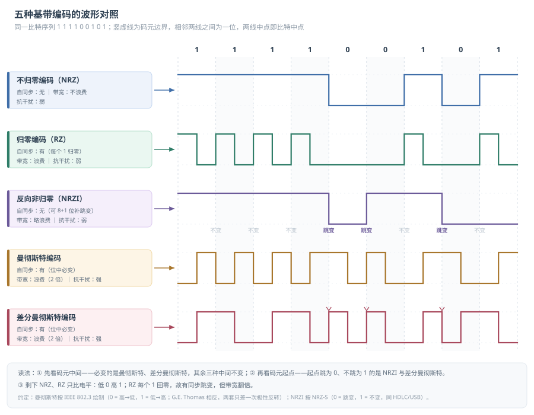
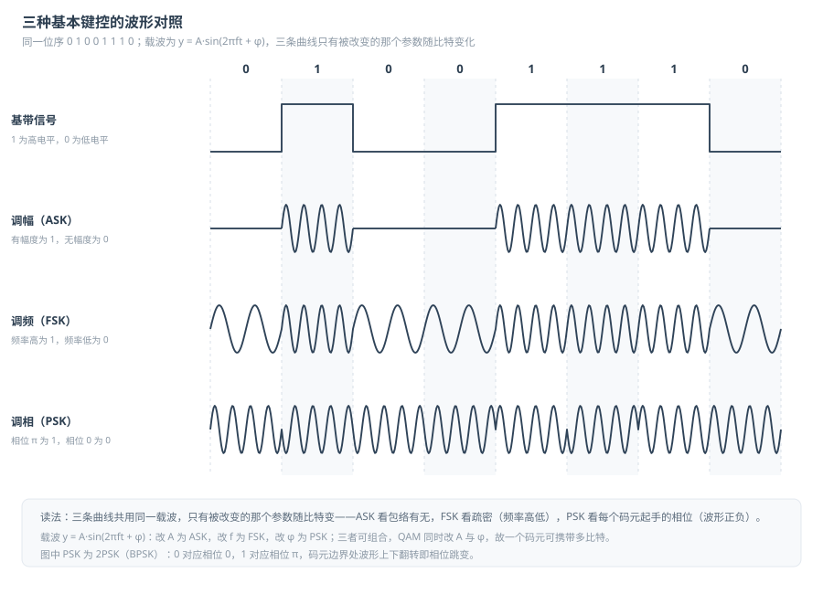

## 物理层基础：信号与编码

物理层考虑的是如何在传输媒体上**传输数据比特流**，而不是传输媒体本身。它的目标是**屏蔽不同传输媒体和通信手段的差异**，为数据链路层提供透明的比特流传输服务。

数据链路层把若干个比特交给物理层，物理层要把它们变成某种信号送上线。这一篇按四步走：先补通信基础概念，再讲比特怎么变成信号（编码与调制），然后算一条信道最快能传多少（奈氏与香农），最后是接口的四大特性。

### 通信基础

#### 信源、信宿、信号与信道

- **信源**：信号的来源，即数据的发送方。
- **信宿**：信号的归宿，即数据的接收方。
- **信号**：数据的载体。二进制数据本身传不远，必须变成某种物理量（电压、光强、电磁波振幅）才能上线。
- **信道**：信号通过的通道。一条物理线路通常对应**两条信道**——一条发送、一条接收。家里的网线同时承担收发，就是两条信道，两个方向的速率可以不同。

信号分两类，区别只在**取值是否连续**：

| 类型 | 取值 | 例子 | 特点 |
| --- | --- | --- | --- |
| 数字信号 | 离散，只有有限种 | 0 V／5 V 两档电压 | 抗干扰强，便于存储处理 |
| 模拟信号 | 连续，可取区间内任意值 | 正弦波、声波、光波 | 适合连续变化，易受噪声影响 |

同一个物理量既能传数字信号也能传模拟信号。以电压为例：约定 −1 V 表示 0、+1 V 表示 1，按比特周期切换电平，就是数字信号；约定用 `sin(2πt)` 表示 1、`sin(2πt+π)` 表示 0，让电压按正弦规律连续变化，就是模拟信号。

**考察形式**：综合知识选择题。


#### 码元、波特率与比特率

**码元**是承载信息的基本信号单元——一个信号周期就是一个码元，其长度称**码元宽度**。一个码元能带几个比特，取决于这个周期内允许出现几种不同的信号：

| 状态数 K | 名称 | 每码元比特数 log₂K |
| --- | --- | --- |
| 2 | 二进制码元 | 1 |
| 4 | 四进制码元 | 2 |
| 8 | 八进制码元 | 3 |
| 16 | 十六进制码元 | 4 |
| 32 | 三十二进制码元 | 5 |

道理很直接：K 种状态需要用 log₂K 位二进制来编号。两种状态只能区分 0 和 1，四种状态可以区分 00、01、10、11，于是每个码元带 2 比特。**每码元比特数 = log₂K**。

两种速率由此区分：

- **波特率**：每秒传输的**码元**数，单位 Baud（波特），等价于「码元每秒」。
- **比特率**：每秒传输的**比特**数，单位 bit/s（bps）。

二者关系：**比特率 = 波特率 × log₂K**。只有二进制码元（K=2）时，波特率才等于比特率。

> 例：某信道每秒传 2000 个四进制码元，波特率 2000 Baud，比特率 = 2000 × log₂4 = 4000 bps。**波特率高，比特率不一定高**，还要看每个码元带几个比特。

**考察形式**：综合知识选择题。

### 编码与调制

#### 编码、解码、调制、解调

二进制数据要变成信号，中间需要两个部件：**变换器**把二进制转成信号，**反变换器**把信号转回二进制。

| 过程 | 方向 | 典型设备 |
| --- | --- | --- |
| 编码 | 二进制 → 数字信号 | 网卡（编码器） |
| 解码 | 数字信号 → 二进制 | 网卡（解码器） |
| 调制 | 二进制 → 模拟信号 | 光猫、Modem（调制器） |
| 解调 | 模拟信号 → 二进制 | 光猫、Modem（解调器） |

- **网卡**：网线接口背后那块芯片，把主机内的二进制编码成数字信号送到网线上；反向则解码后交给主机。
- **光猫**：本质是**调制解调器**（modem，谐音「猫」），把二进制调制成光信号送入光纤，或把光信号解调回二进制。家庭宽带的规范名称是光网络终端（ONT），运营商侧对应光线路终端（OLT）。

**考察形式**：综合知识选择题。


#### 基带信号与带通信号

**基带信号**：来自信源的原始电信号，没有经过频率搬移，频带从零频或很低频率开始。

**带通信号**：经过载波调制，把频率范围搬到较高频段，最低频率不为零。

- **基带传输**：在数字信道上直接传基带信号（局域网、以太网）。
- **带通传输**：在带通信道上传调制后的信号（无线、电话线）。

> 传输数字信号的信道叫**数字信道**，传输模拟信号的信道叫**模拟信道**。简单对应：**数字信道用基带传输，模拟信道用带通传输**。网线标准里的「BASE」即基带；无线与拨号必须调制。

**考察形式**：综合知识选择题。


#### 基带编码（数字 → 数字）

把二进制直接变换成数字波形，在数字信道上传输。评价一种编码看三件事：**0 与 1 靠什么区分**、**接收端能否从波形恢复位边界（自同步）**、**抗干扰能力**。同一串比特在五种编码下的波形如下。



> 图 3.1：比特序列 `1 1 1 1 0 0 1 0 1` 在五种基带编码下的波形与判读规则

判读按固定顺序：**先看比特中间有无跳变**——中间必变的是曼彻斯特与差分曼彻斯特；**再看比特起点有无跳变**——起点跳为 0、不跳为 1 的是 NRZI 与差分曼彻斯特。剩下的 NRZ、RZ 只比电平高低。

| 编码 | 比特中间 | 比特起点 | 0 与 1 的分界 | 自同步与带宽 | 抗干扰 |
| --- | --- | --- | --- | --- | --- |
| 不归零（NRZ） | 不变 | 不变 | 低电平为 0，高电平为 1 | 无自同步；长串同值无跳变，需额外时钟线 | 弱 |
| 归零（RZ） | 必归零 | 不变 | 前半位为高是 1，为低是 0 | 每位归零提供时钟；脉宽减半，带宽约为 NRZ 两倍 | 弱 |
| 反向非归零（NRZI） | 不变 | 有跳变为 0，无跳变为 1 | 只看起点有无跳变 | 无自同步；可每 8 位加 1 位冗余（8+1）补跳变 | 弱 |
| 曼彻斯特 | 必变 | 不用于判读 | **IEEE**：低→高为 0，高→低为 1；原始标准相反 | 每位一次跳变，自同步；带宽约为 NRZ 两倍；10BASE-T 使用 | 强 |
| 差分曼彻斯特 | 必变（仅作同步） | 有跳变为 0，无跳变为 1 | 只看起点有无跳变，中间跳变只提供时钟 | 自同步；802.5 令牌环使用 | 强 |

四处容易混的地方：

- **NRZI 与差分曼彻斯特的起点规则相同**（跳 0 不跳 1），差别在中间：NRZI 中间不变，差分曼彻斯特中间必变，后者因此同时具备起点信息与每比特一次的时钟。
- **曼彻斯特与差分曼彻斯特的中间规则相同**（必变），差别在 0/1 落在哪里：曼彻斯特用中间跳变的**方向**，差分曼彻斯特用起点跳变的**有无**。
- **看电平还是看跳变，决定抗极性反转能力**：NRZ、RZ 依赖绝对电平，线序接反就读错；NRZI 与差分曼彻斯特只看有无跳变，双绞线对调仍能正确判读。
- **曼彻斯特有两套相反的标准**。G.E. Thomas 1949 年提出时规定高→低为 0、低→高为 1；IEEE 802.3 规定低→高为 0、高→低为 1。**408 默认 IEEE**，判读前先看题目给的是哪套；只记「中间必变、方向区分 0/1」，把方向对调即可互换。

> 图 3.1 的曼彻斯特按 IEEE 802.3 绘制：低→高为 0、高→低为 1。G.E. Thomas 的原始标准相反，若题目按原始标准出波形，把两个方向对调即可。

**判波形的真题套路**（2015、2021 年考过）：

1. 看比特**中间**有没有跳变：没有的是 NRZ、RZ、NRZI，有的是曼彻斯特、差分曼彻斯特。
2. 中间不变的三种里，看**起点**：起点跳变的是 NRZI（跳 0），再看电平高低区分 NRZ（低 0 高 1）与 RZ（前半位高为 1、中间归零）。
3. 中间必变的两种里，看**中间跳变方向**能否与比特一一对应：能对应的是曼彻斯特，不能对应（方向只作时钟）的是差分曼彻斯特。
4. 差分曼彻斯特再用**起点**判 0/1：跳 0 不跳 1。

**4B/5B 编码**：每 4 位数据映射为 5 位码组，保证码组内**连续 0 不超过 3 个**，使后续 NRZI 一定有跳变而维持同步；编码效率 80%，用于百兆以太网光纤（100BASE-FX）。

**考察形式**：综合知识选择题。

#### 带通调制（数字 → 模拟）

为什么要把数字信号调制成模拟信号？两个原因：

- **有些信道只能传模拟信号**。真空（卫星通信）、早期电话线只允许模拟波形通过；双绞线两者都行。
- **模拟信号抗干扰更强、适合长距离**。长距离传输通常先调制再发送。

载波写成 `y = A·sin(2πft + φ)`，三个参数可变，改哪个就是哪种键控：改幅度是 **ASK**，改频率是 **FSK**，改相位是 **PSK**。同一串比特在三种键控下的波形如下。



> 图 3.2：比特序列 `0 1 0 0 1 1 1 0` 在 ASK、FSK、PSK 下的波形与判读规则

判读只看一个量：**哪个参数随比特变化**。

| 键控方式 | 改变的参数 | 0 与 1 的分界 | 判读要点 | 典型应用 |
| --- | --- | --- | --- | --- |
| 幅移键控（ASK，调幅，AM） | 幅度 A | 有载波为 1，无载波为 0 | 看包络有无；实现最简单，抗噪最差 | 红外遥控、RFID、早期 Modem |
| 频移键控（FSK，调频，FM） | 频率 f | 高频为 1，低频为 0 | 看波形疏密；恒包络，抗噪好但占带宽 | 蓝牙（GFSK）、寻呼、低速 Modem |
| 相移键控（PSK，调相，PM） | 相位 φ | 相位 π 为 1，相位 0 为 0（BPSK） | 看每个码元起手的相位；恒包络 | 卫星通信、Wi-Fi 低速档 |
| 正交振幅调制（QAM） | 幅度 A 与相位 φ | 每个码元对应一个 (A, φ) 组合 | 一个码元带 log₂(MN) 比特 | Wi-Fi、4G/5G、有线电视、ADSL |

**多进制调制**：只设计两种状态，一个码元只能带 1 比特。多设计几种状态就能多带：

- ASK 多设几个幅值（如 4 种），每码元 2 比特；
- FSK 多设几个频率，每码元 log₂K 比特；
- PSK 多设几个相位（如 QPSK 四相位），每码元 2 比特；
- **QAM 把幅度与相位组合**：M 种幅度 × N 种相位 = M×N 种状态，每码元 log₂(MN) 比特。

QAM 后面的数字就是**总状态数**，等于 M×N：

| 名称 | 状态数 | 每码元比特 | 常见场景 |
| --- | --- | --- | --- |
| 16QAM | 16 | 4 | 早期 ADSL、Wi-Fi 低速档 |
| 32QAM | 32 | 5 | 数字微波 |
| 64QAM | 64 | 6 | Wi-Fi 5、4G |
| 128QAM | 128 | 7 | 有线电视、部分微波 |
| 256QAM | 256 | 8 | Wi-Fi 5/6、5G、有线电视 |

阶数越高，单位时间传的比特越多，但**星座点越密，对信噪比要求越高**——Wi-Fi 信号弱时自动降到低阶调制，原因就在这里。

三点要注意：

- **ASK 的极端形式是 OOK**：0 时载波关断、只有 1 时有载波；包络形状与基带方波一致，把基带信号与载波相乘就得到 ASK 波形。
- **FSK 与 PSK 都是恒包络**：信息不落在幅度上，信道衰减与非线性放大不改变判决结果，抗噪优于 ASK；代价是 FSK 占更宽频带，PSK 对载波同步要求更高。
- **QAM 是幅度与相位的联合**：本质是两个函数的复合，M 个幅度函数与 N 个相位函数两两组合，得到 M×N 种波形。

> 与上一小节的分工：**基带编码决定比特怎么变成电平，带通调制决定这段电平怎么搬到载波上**。两者可叠加：100BASE-FX 用 4B/5B + NRZI 直接基带传输，Wi-Fi 用 QAM 把比特搬到 2.4 GHz／5 GHz 载波。

**考察形式**：综合知识选择题。

### 信道的极限容量

一条信道最快能传多少？受两个因素限制：**带宽**与**噪声**。奈氏准则回答无噪声时的码元上限，香农定理回答有噪声时的比特上限。

#### 带宽与噪声

先用第一章的两种带宽含义对齐：

- 计算机网络里，带宽指**最高数据率**，单位 bps。
- 通信原理里，带宽指信道允许通过的**信号频带范围**，单位 Hz。

两者本质相同：带宽越大，信道传数据的能力越强。奈氏与香农就是这两种含义之间的桥。

**噪声**指信道上除有用信号之外的一切干扰。网线周围有强电场、强磁场，就会在信号上叠加噪声。用听觉信道类比：人耳可听 20 Hz～20 kHz，带宽约 19980 Hz；两个人说话时，第三个人在旁边大声背单词，他的声波就是噪声。

**信噪比（S/N）**：信号功率与噪声功率之比，无单位。S 是 signal，N 是 noise。信噪比越高，噪声影响越小。提高信噪比有两条路：提高信号功率，或降低噪声功率。

信噪比常常很大（网线的信号功率比噪声高十几个数量级），直接写不便，于是用**分贝**：

**dB = 10·log₁₀(S/N)**

| S/N | dB |
| --- | --- |
| 10 | 10 dB |
| 100 | 20 dB |
| 1000 | 30 dB |
| 10¹⁹ | 190 dB |

> 代入香农公式的必须是**无单位的 S/N**，不是 dB。题目给 30 dB，先换成 1000 再算。

**考察形式**：综合知识选择题。

#### 奈奎斯特准则：无噪声信道的码元上限

**奈奎斯特定理（奈氏准则）**：对一个**无噪声**、带宽为 W（Hz）的理想低通信道，极限波特率为 **2W Baud**。

即每秒最多传 2W 个码元。超过这个速率，码元之间会相互串扰，接收方无法识别。

换算成比特率：**C = 2W·log₂K**（K 为一个码元的状态数）。

- W 越大，能传的码元越多；
- K 越大，每个码元带的比特越多；
- 但奈氏只规定了码元速率上限，**没有规定一个码元能带多少比特**——那是调制方式决定的事。

> **前提要认准**：「理想低通信道」「无噪声信道」都是使用奈氏准则的标志。题目说「无噪声」，就用奈氏，不要碰香农。

**例（2022 年真题改编）**：带宽 200 kHz 的无噪声信道，采用 4 幅值 ASK 调制，求最大数据传输速率。

- 4 幅值 = 4 种状态，每码元 log₂4 = 2 比特。
- 极限波特率 = 2 × 200k = 400k Baud。
- 最大比特率 = 400k × 2 = **800 kbps**。

**考察形式**：综合知识选择题。

#### 香农定理：有噪声信道的比特上限

**香农定理**：对带宽为 W、信噪比为 S/N 的有噪声信道，极限比特率为

**C = W·log₂(1 + S/N)**

- 单位是 bps；W 用 Hz，S/N 用无单位比值。
- W 越大、S/N 越高，极限速率越高。
- 结论的意义：**只要传输速率低于 C，总存在某种编码方式实现无差错传输**；超过 C 就不可能。

**例（2016 年真题改编）**：链路带宽 8 kHz，信噪比 30 dB，实际速率是理论最大的 50%，求实际速率。

- 30 dB → S/N = 1000。
- C = 8000 × log₂(1001) ≈ 8000 × 9.97 ≈ 80 kbps。
- 实际 = 80k × 50% = **40 kbps**。

> 题目给「有噪声」「信噪比」，只能用香农；若同时要求码元数，再用奈氏反推。

**考察形式**：综合知识选择题。

#### 两个定理怎么配合

| 维度 | 奈奎斯特准则 | 香农定理 |
| --- | --- | --- |
| 适用信道 | 无噪声、理想低通 | 有噪声、带宽有限 |
| 限制对象 | 码元速率（波特率） | 信息速率（比特率） |
| 公式 | 2W Baud；C = 2W·log₂K | C = W·log₂(1 + S/N) |
| 关键变量 | 带宽 W、状态数 K | 带宽 W、信噪比 S/N |

两者结合能推出一个重要结论：**带宽与信噪比都确定时，一个码元能携带的比特数也有上限**。因为香农给出了比特率上限，奈氏给出了码元速率上限，两者相除就是每码元比特数的上限。不可能无限提高调制阶数。

**例（2009 年真题改编）**：带宽 3 kHz 的无噪声信道，采用 QAM 调制，4 种相位 × 4 种振幅，求最大数据率。

- 状态数 = 4 × 4 = 16，每码元 log₂16 = 4 比特。
- 极限波特率 = 2 × 3k = 6k Baud。
- 最大比特率 = 6k × 4 = **24 kbps**。

**JS 演示**：两条极限速率公式的函数化，并演示「由香农上限反推所需状态数」的配合用法。

```js
// 奈氏：C = 2W·log2K；香农：C = W·log2(1 + S/N)，S/N 由 dB 换算
const nyquist = (w, k) => 2 * w * Math.log2(k);
const shannon = (w, snrDb) => w * Math.log2(1 + 10 ** (snrDb / 10));
console.log(nyquist(3000, 16));     // 24000：3 kHz、16 状态 → 24 kbit/s
console.log(shannon(3000, 30));     // 约 29902：3 kHz、30 dB（S/N = 1000）

// 配合用法：香农给出上限后，反推奈氏侧所需状态数 K = 2^(C / 2W)
console.log(Math.round(2 ** (shannon(3000, 30) / (2 * 3000))));   // 32：约 32 状态逼近上限
```

**考察形式**：综合知识选择题。

### 物理层接口的特性

物理层接口（连接 DTE 与 DCE 的接口）有四大特性：

- **机械特性**：接口形状、尺寸、引脚数目和排列。
- **电气特性**：电压范围、传输速率、距离限制。
- **功能特性**：某电平的电压表示何种意义（如 0/1）。
- **规程特性**：不同功能的各种事件的出现顺序。

**考察形式**：综合知识选择题。
