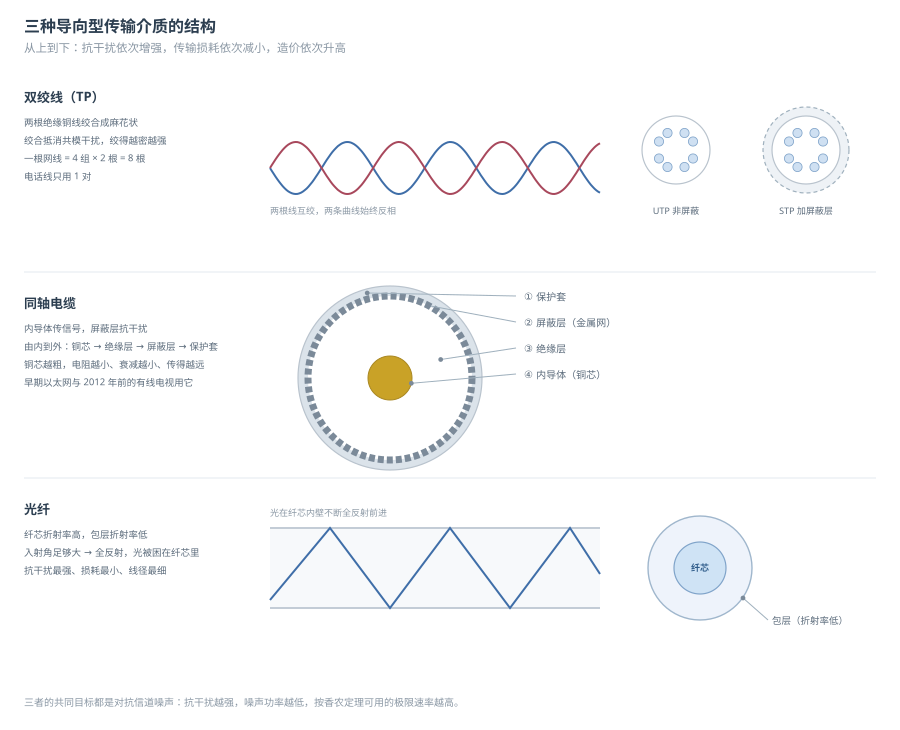
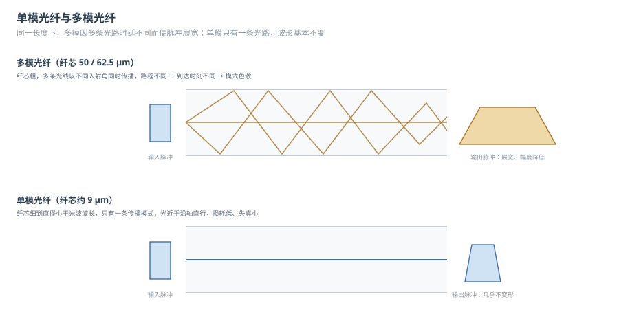
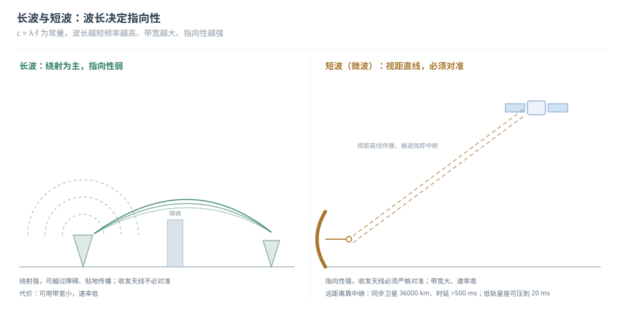
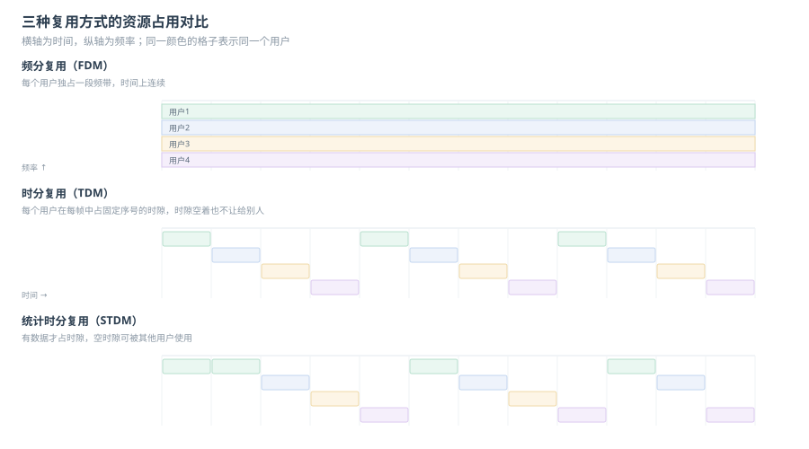
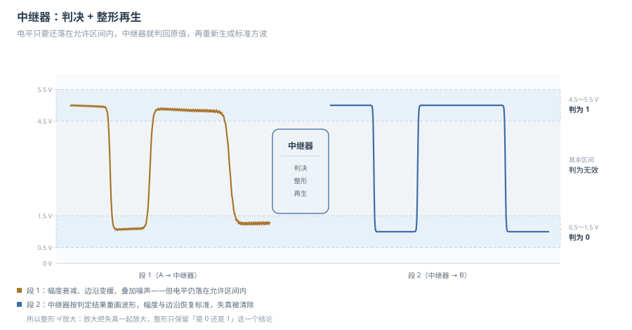
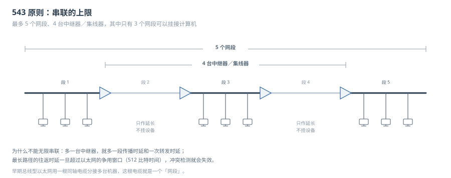
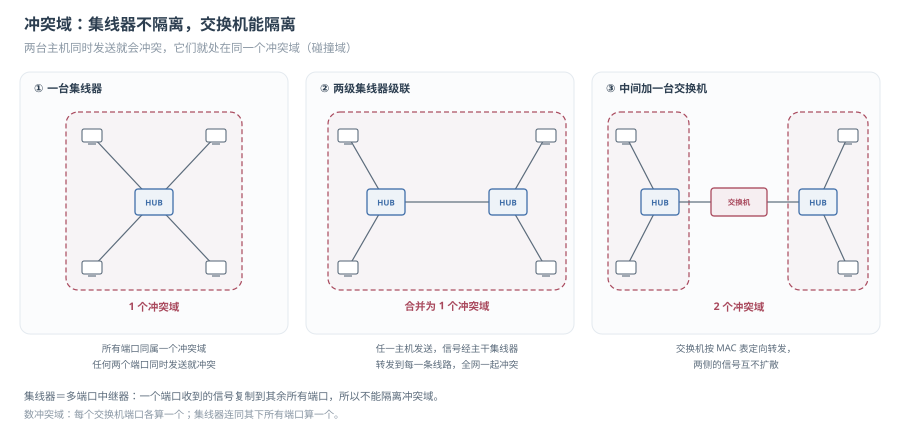

## 传输介质与信道复用

网络传输介质是传输信息的载体，分**导向型**与**非导向型**两类：导向型让信号沿固定方向传播（有线介质），非导向型让信号向四面八方扩散（无线）。物理层的另一项任务是**信道复用**，让多路信号共享同一条介质。

这一篇讲五块：三种有线介质、无线介质、物理层接口的四特性、信道复用，最后补物理层设备（中继器与集线器）。

### 传输介质

#### 有线传输介质

有线介质把信号约束在线缆内传播，主要有双绞线、同轴电缆、光纤三种。按**抗干扰由弱到强、损耗由大到小**排，依次是双绞线 → 同轴电缆 → 光纤。

> 图 4.1：三种导向型介质的结构——从上到下抗干扰增强、损耗减小、造价升高

**双绞线（TP，Twisted Pair）**：两根绝缘铜线相互绞合，像拧麻花。绞合的意义在于**抵消电磁干扰**——外界干扰在两根绞线上感应出的电压几乎相同，接收端做差分即可抵消，绞得越密效果越好。

- **非屏蔽双绞线（UTP）**：没有屏蔽层，日常网线就是它。
- **屏蔽双绞线（STP）**：外层加铝箔或编织金属网，进一步隔离干扰。

一根网线内部是**四组双绞线**（共 8 根线），电话线只用一对。等级决定速率：

| 类别 | 典型速率 | 说明 |
| --- | --- | --- |
| 5 类 / 超 5 类 | 100 Mbps / 1 Gbps | 百兆、千兆网线 |
| 6 类 | 10 Gbps（100 m 内） | 内部有十字骨架，抗串扰更好 |
| 8 类 | 40 Gbps（30 m 内） | 双层屏蔽，短距万兆以上 |

提升网线速率只有两条路：**绞得更密**（工艺更难、成本升）或**加屏蔽层**（费材料、成本升）。两者本质都是降低噪声功率，从而提高信噪比——按香农定理，信噪比上去，极限速率就上去。

**同轴电缆**：由内到外四层——**内导体（铜芯）**传输信号、**绝缘层**、**外导体屏蔽层**（金属网，抗干扰）、**保护套**。内导体越粗，电阻越小，衰减越小，传输距离越远，成本也越高。

早期以太网与 2012 年前的有线电视都用同轴电缆；三网融合（电话、电视、互联网合一）后，电视信号逐渐改走光纤。

**光纤**：由**纤芯**与**包层**组成，两者都透明，但**包层折射率更低**。光从高折射率的纤芯射向低折射率的包层，入射角足够大时发生**全反射**，沿纤芯内壁不断反射前进。

光纤的三个优势：

- **抗干扰最强**：光信号不受电磁场影响，旁边有强电强磁也几乎不干扰。
- **损耗最小**：长距离传输需要的中继器少，成本低。
- **细**：布线省空间。

**中继器**的作用是接收衰减、失真的信号，整形再生后再发出去。光纤损耗小，长距离传输时中继器可以少放甚至不放；双绞线与同轴则要放很多。

单模与多模的区别：

| | 单模光纤 | 多模光纤 |
| --- | --- | --- |
| 纤芯直径 | 约 9 μm，极细 | 50／62.5 μm，较粗 |
| 传输方式 | 只有一种传播模式，光路贴近轴心 | 多条光线以不同入射角同时传播 |
| 容量 | 只能传一条光路 | 可同时传多条光路 |
| 损耗与距离 | 损耗低，适合长距离、骨干 | 模式色散明显，适合短距离 |
| 外皮颜色 | 黄色 | 橙色或青绿色 |

> 外皮颜色是行业约定：黄色单模，橙／青绿多模。家里入户的光纤通常是黄色单模。

> 图 4.2：单模与多模的光路与脉冲展宽——同样长度下多模输出脉冲更宽、幅度更低

**三种介质的对比**：

| 介质 | 抗干扰 | 传输损耗 | 距离 | 成本 |
| --- | --- | --- | --- | --- |
| 双绞线 | 弱（靠绞合与屏蔽） | 较大 | 100 m 量级 | 最低 |
| 同轴电缆 | 中（金属网屏蔽） | 中 | 200 m 量级（粗缆 500 m） | 中 |
| 光纤 | 最强（免疫电磁干扰） | 最小 | 数十公里 | 最高 |

**以太网对介质的命名**：`速度 + BASE + 介质信息`。

- **速度**：Mbps 数，如 10、100、1000、2.5G。
- **BASE**：baseband，基带传输，即直接传数字信号（10BASE-T 用曼彻斯特编码，高速以太网改用 4B/5B、PAM-5 等）。
- **介质信息**：数字表示最大段长（百米），字母表示介质——**T／TX 为双绞线，F 为光纤**。

| 名称 | 速率 | 介质 | 段长 |
| --- | --- | --- | --- |
| 10BASE5 | 10 Mbps | 粗同轴电缆 | 500 m |
| 10BASE2 | 10 Mbps | 细同轴电缆 | 200 m（标准实际 185 m） |
| 100BASE-TX | 100 Mbps | 双绞线 | 100 m |
| 1000BASE-T | 1000 Mbps | 双绞线 | 100 m |
| 1000BASE-SX | 1000 Mbps | 多模光纤 | 数百米 |
| 2.5GBASE-T | 2.5 Gbps | 双绞线 | 100 m |

> 看到 BASE 后面跟数字，就是同轴电缆，数字是百米数；跟 T 是双绞线；跟 F 是光纤。真题考过这条规则。

**考察形式**：综合知识选择题。

#### 无线传输介质

无线介质是自由空间，靠电磁波携带信息。所有无线通信本质都是电磁波，只是**波长不同**，叫法不同。

**波长、频率与光速**：`c = λ·f`。c 是光速（常量），波长与频率成**反比**——波长越短，频率越高，可用频带越宽，数据传输能力越强。

**无线电波**（手机信号、Wi-Fi）：

- **穿透能力强**：隔几堵墙仍能收到。
- **传输距离长**：手机与基站可以相距很远。
- **指向性弱**：信号向四面八方扩散，不必对准。

**微波／短波**（卫星通信、微波中继）：

- 波长短、频率高，**可用带宽大，传输能力强**。
- **指向性强**：波长越短越接近直线传播，收发天线必须对准。农村的卫星电视「大铁锅」要调方向，就是这个原因。
- 绕射能力弱，不能穿墙绕弯，长距离必须建**中继站**。

**长波**：波长长，**绕射性好**（俗称穿墙能力强），指向性弱，适合非直线、远距离通信，但带宽小、速率低。

> 一句话：**长波绕、短波直**。长波靠绕射覆盖，短波靠视距直达，所以卫星与微波都要对准。

> 图 4.3：长波与短波——波长越短，绕射越弱、指向越强、可用带宽越大

**卫星通信**：卫星就是天上的中继站。地球同步卫星距地面约 36000 km，信号上下一个来回传播时延超过 500 ms；低轨卫星群（如星链）距地面近，时延可压到 20 ms 以内，代价是需要成百上千颗卫星组网。

**红外线、激光**也属电磁波：红外用于短距遥控，激光用于点对点视距通信，都怕遮挡。

**介质选择的五个维度**：吞吐量与带宽、成本、尺寸与可扩展性、连接器、抗噪性。

**考察形式**：综合知识选择题。

#### 物理层接口的四特性

物理层协议要规定主机与传输介质之间接口的四件事，用网线（RJ-45 水晶头）最好理解：

- **机械特性**：接口形状、尺寸、引脚数目与排列、锁定装置。水晶头的长宽、8 个引脚、内部 8 根线与引脚的对应关系，都属机械特性。
- **电气特性**：每条线上允许的电压范围、传输速率、最大线缆长度、工作温度、供电电压等。例如五类 UTP 规定工作温度 −55℃～60℃、最大供电电压 125 V（不同类别取值不同）。
- **功能特性**：某条线上出现某个电平代表什么意义。例如千兆以太网的四对线同时双向传输，每对线上的电平组合对应不同的比特。
- **过程特性（规程特性）**：不同功能的各种事件的出现顺序。例如插上网线该做什么、拔掉网线该做什么。

> **电气特性与功能特性的分界**：电气特性只说「电压可能在什么范围」，**不给具体电压赋予含义**；功能特性才说「这个电平代表 1、那个代表 0」。两者最容易混。

**考察形式**：综合知识选择题。

### 信道复用技术

**复用**：让多个用户在同一个共享信道上同时通信且互不干扰。主要有四种复用方式：

> 图 4.4：三种复用方式的资源占用——同一颜色代表同一用户

三种方式的差别可以直接从图上读出来：**FDM 切频带**（每人一段频率，时间上连续）、**TDM 切时隙**（每人固定序号的时隙，轮转使用）、**STDM 只在有数据时才占时隙**，空出来的时隙可以让给别人。

#### 频分复用（FDM）

所有用户在**同样的时间**占用**不同的频带**资源，适合模拟信号；频分多址（FDMA）是其接入形式。

做法是把信道总频带切成若干**互不相交的子频带**，每对用户固定占一段；相邻子频带之间留出**隔离频带**，防止边带相互重叠造成串扰。总频带范围就是常说的信道带宽（以 Hz 计），用户只分到其中一段，因此单用户的传输速率达不到整条信道的最高速率。

- **复用器与分用器**：发送端用**复用器**把多路信号合成一路送上传道，接收端用**分用器**按频率把各路拆开、交给对应接收方。
- **多用于模拟信号**：按频率划分天然适合模拟信号；数字信号要先调制成不同载频的模拟信号，才能纳入频分体系（ADSL 即如此）。

**考察形式**：综合知识选择题。

#### 时分复用（TDM）

将时间划分为等长的 TDM 帧，每个用户在每帧中占用固定序号的时隙；**统计时分复用（STDM）**按需动态分配时隙，提高利用率。

一个 **TDM 帧**是一个完整的时间周期，再等分为 M 个时隙；每个发送方在每帧里固定占一个时隙，**相对位置不变**（例如 1 号时隙永远归 A 站），接收方按位置即可区分各路信号。

代价有两条：每用户最多只能用到总带宽的 **1/M**；**用户没有数据时它的时隙照样空转**，别人不能借用，信道利用率因此不高。

**统计时分复用（STDM，又称异步 TDM）**：先统计各用户的实际发送需求，再**动态按需分配时隙**——某站数据多时可以占满整帧，没有数据的站干脆不占位置。于是单个用户有可能在一段时间内用上全部带宽，利用率明显高于固定 TDM。代价是时隙不再与用户固定绑定，需要额外的控制信息标明"这个时隙属于谁"。

**考察形式**：综合知识选择题。

#### 波分复用（WDM）

光的频分复用，一根光纤同时传输多个光载波（波长）信号；密集波分（DWDM）可达数十路。

本质仍是**按频率划分**：光速恒定，λ × f = c，波长与频率一一对应，按波长分路等价于按频率分路。光纤可用的频带极宽，能容纳的波长数远多于电缆里的频段数，所以一条光纤在逻辑上可以被拆成许多条子信道——这正是 WDM 特别适合光纤的原因。

**考察形式**：综合知识选择题。

#### 码分复用（CDM/CDMA）

各用户使用相互**正交的码片序列**，同一时间、同一频带并行通信互不干扰；接收方用发送方的码片序列做规格化内积即可分离信号（结果为 +1 / −1 / 0 分别表示发送比特 1 / 0 / 未发送）。

> **复用方式速记**：FDM 分**频率**、TDM 分**时间**、WDM 分**波长**（光频）、CDMA 分**码片**。核心思想都是「正交隔离、互不干扰」。

**考察形式**：综合知识选择题。

### 物理层设备

#### 中继器

信号在介质中传输会因电阻、电容逐渐**失真**，距离越长失真越严重，接收方可能判错比特。以太网因此限制每段介质的长度（10BASE5 为 500 m、10BASE2 为 200 m）。

要延长覆盖距离，就得在中间加**中继器**：

- **两个端口**，一个收、一个发，方向可逆但**不能同时收发**，只支持**半双工**。
- 收到信号后先判断电平落在哪个区间（如 0.5～1.5 V 为低、4.5～5.5 V 为高），只要没超出允许范围，就认定原值，再**整形再生**为标准电平发出去。
- 整形再生需要时间，会产生**时延**。
- 两个端口对应两个**网段**，把两个网段连成一个更大的网段。

> 整形再生不等于放大：放大是把失真波形整体放大，失真还在；整形是按判决结果重新生成标准波形，失真被清除。

> 图 4.5：中继器的判决与整形再生——判的是「落在哪个区间」，不是「原来是什么波形」

**中继器不能无限串联**。以太网有 **543 原则**：最多串联 **5 个网段**，最多使用 **4 台中继器／集线器**，且只有 **3 个网段**可以挂接计算机。早期总线型网络里，一根同轴电缆上可以分接多台机器，中间两段只作延长，不挂设备。

> 图 4.6：543 原则——5 段、4 台、3 段可挂机；多一段就多一份时延，往返时延超出争用窗口后冲突检测失效

**考察形式**：综合知识选择题。

#### 集线器与冲突域

**集线器（HUB）本质是多端口中继器**：一个端口收到的信号，整形再生后**转发到其余所有端口**。

由此带来四个特点：

- **广播式发送**：所有端口都能收到，存在被窃听的风险。
- **半双工**：同一时刻只允许一个端口发送，多台同时发就冲突。
- **共享带宽**：10 Mbps 的集线器接 8 台主机，平均每台只有 1.25 Mbps。
- **物理星形、逻辑总线**：线都接到盒子上，物理是星形；内部是一条共享总线，数据广播给所有端口，逻辑仍是总线型，存在总线争用。

**冲突域**：如果两台主机同时发送就会冲突，它们就处于同一个冲突域（也叫碰撞域）。集线器的所有端口在同一个冲突域里，**集线器不能隔离冲突域**。

多台集线器级联，冲突域会**合并成一个更大的冲突域**：任一主机发送，信号经主干集线器转发到每条线路。要让冲突域彼此隔离，需要交换机（见《以太网交换与 VLAN》）。

> 图 4.7：冲突域的合并与隔离——集线器「复制到所有端口」所以不隔离，交换机按 MAC 表定向转发所以能隔离

> **真题识别设备图标**：立方体加单向箭头是集线器，加双向多箭头是交换机，圆柱体加多方向箭头是路由器。数冲突域时，交换机的每个端口各算一个，集线器连同其下所有端口算一个。2020 年真题：4 台集线器各成一段，被 2 台交换机隔开，冲突域共 4 个。

**教材与现实的差异**（做题按教材，知道即可）：

- 教材说中继器／集线器不能连接物理层协议不同的网段；现实中集线器可以（如一台设备同时提供同轴与双绞线接口，内部做编码转换）。
- 教材说不能连接速率不同的网段；现实中可以，但会**向下兼容**——接一个十兆口，全设备按十兆跑。

**考察形式**：综合知识选择题。
