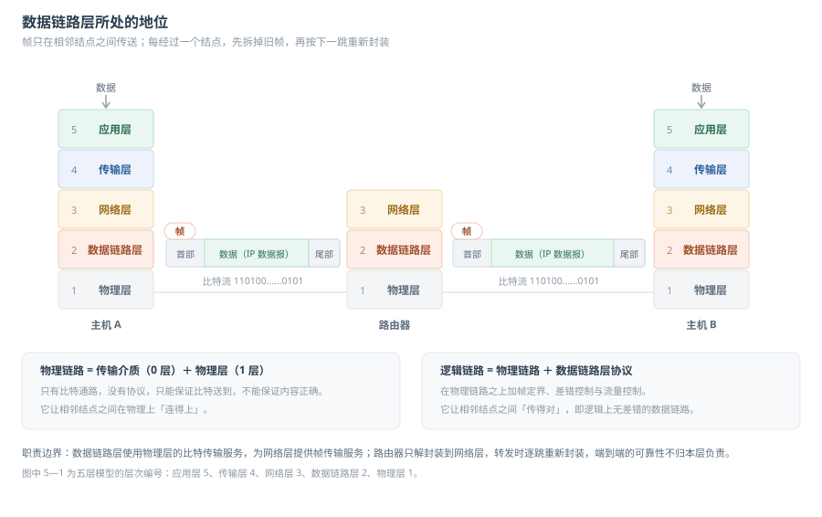

## 数据链路层与差错控制

数据链路层把物理层送来的比特流组织成一帧一帧的数据，在**相邻结点**之间提供"逻辑上无差错"的传输。它下承物理层的比特服务，上为网络层搬运 IP 数据报，是五层结构中唯一同时要处理"帧的边界"与"比特的错误"的一层。

本篇按功能主线展开：先在五层结构中定位，梳理五项功能与三类服务；再把组帧与查错拆开细讲——封装成帧解决"一帧从哪开始、到哪结束"以及"数据里撞上定界符怎么办"，差错控制解决"一个帧内部的比特翻转怎么发现、要不要纠正"。

> **教材对照**：2025 版王道教材中 3.1.2 与 3.1.3 两小节可跳过不看，新版图书将删去这两部分；本篇按功能组织，不按教材小节编号排列。

### 数据链路层概述

#### 数据链路层的位置与基本概念

**数据链路层**：是计算机网络体系结构中的**第二层**，负责在相邻结点之间的链路上，把网络层交付的分组封装成帧并以**帧**为单位传送，同时向网络层提供尽量无差错的数据传输服务。数据链路层的协议数据单元是**帧（frame）**，由数据部分加上帧头、帧尾构成；本层把物理层"看不出结构的比特流"组织成"一帧一帧"的数据，这正是它与物理层的分界。

三个基础概念先行厘清：

- **链路（link）**：一条无源的物理线路段（一段网线、一段光纤），由传输介质与物理层构成，本身不具备传输数据的控制能力，也称**物理链路**。
- **数据链路（data link）**：链路加上实现通信协议的**硬件和软件**（网络适配器与驱动程序）之后，才成为真正能传送数据的通路，链路层的协议实际运行在"数据链路"上，也称**逻辑链路**。
- **相邻结点**：指同一条链路上直接相连、中间不经过其他转发设备的两个结点。

**"逻辑上无差错"不是修辞**：物理链路只能保证比特"送得出去"，不能保证"原样到达"——线路上有环境噪声、电磁干扰与信号衰减，0 可能翻成 1、1 可能翻成 0。数据链路层能做的不是让错误不发生，而是让错误**可被发现**：用检错编码查出坏帧，再丢弃或请求重传。所以"无差错"描述的是**网络层看到的效果**，链路上的比特错误依然真实存在；差错控制做的是让错误暴露，不是让错误消失。

> 三层分工速记：物理层"传比特"，数据链路层"在相邻结点之间传帧"，网络层"在源主机与目的主机之间选路、传分组"。数据链路层的传输范围**仅限相邻结点之间**；跨越整条路径的端到端传输由网络层负责，本层只对"每一跳"负责。

把上述分层落到具体结点上，就是下面这张位置图：



> 图 5.1：数据链路层所处的地位——帧只在相邻结点之间逐跳传送，路由器只解封装到网络层

**上下服务关系**：网络层把 IP 数据报交给链路层；链路层加上首部与尾部封装成**帧**，再请求物理层把帧转成比特送上线；相邻节点的物理层收到比特后交给链路层，链路层拆掉首尾、还原出 IP 数据报，再交给网络层。对网络层，它是**服务提供者**；对物理层，它是**服务请求者**。

**考察形式**：综合知识选择题。


#### 数据链路层的五大功能

先固定三个术语：网络层交下来的 IP 数据报是数据链路层的 **SDU（服务数据单元）**；本层为控制协议运行而加的首部与尾部是 **PCI（协议控制信息）**；两者合起来才是本层的 **PDU（协议数据单元）**，也就是**帧**。写成式子即 **帧 ＝ 首部 ＋ SDU ＋ 尾部**。下文讲"透明"，核心就是接收方能否从这个帧里把 SDU **原样**取回。

数据链路层的功能可归纳为五项，分别回答"如何组帧、如何查错、如何不丢不重、如何不冲垮接收方、如何共享介质"的问题。

| 功能 | 要解决的问题 | 关键点 |
| --- | --- | --- |
| **封装成帧**（组帧） | 帧定界：接收方如何从连续比特流中确定一帧从哪开始、到哪结束 | 物理层只送比特串，一串里可能有一帧也可能有多帧；定界靠定界符、长度字段或编码违例，详见「封装成帧」 |
| | 透明传输：数据里恰好出现与定界符相同的比特组合，也不能被误判成边界 | 接收方要能从帧中**恢复原始 SDU**；网络层感知不到「加首部／尾部、改数据」的过程，这才叫透明。靠填充或转义实现 |
| **差错控制** | 帧内部的**位错**：传输中 0 变 1、1 变 0 | 方案一：用**检错编码**发现错误后**丢弃该帧**，让发送方重传（最常用）；方案二：用**纠错编码**定位出错的比特并直接纠正。纠错是检错的进阶，代价更高 |
| **可靠传输** | **帧错**三种：帧丢失、帧重复、帧失序 | 丢失：发 1 2 3 4 只收到 1 2 4，要发现 3 缺失并要求重发；重复：收到 1 2 3 3 4，丢弃重复的 3；失序：收到 1 3 2 4，重排回 1 2 3 4。手段是**序号＋确认＋重传**（滑动窗口），详见《可靠传输与滑动窗口》 |
| **流量控制** | 发送方发得太快，接收方来不及接收 | 限制发送方的发送速率；通常与可靠传输共用**滑动窗口**，由接收窗口大小反过来约束发送 |
| **介质访问控制** | 广播信道上多个结点争用同一段传输介质 | **广播信道**（逻辑上总线型拓扑）必须实现：用协议决定使用权先给谁；**点对点信道**通常不需要——介质专属，且多支持全双工，两端可同时收发 |

> **别把差错控制和可靠传输混为一谈**：差错控制盯的是**一个帧内部的比特**（位错），手段是编码；可靠传输盯的是**帧这一级的事件**（丢失、重复、失序），手段是序号、确认与重传。位错没解决，帧错无从谈起；位错解决了，帧错仍可能发生。

> 记忆线索：五项功能对应"**组、查、稳、控、访**"。其中可靠传输与流量控制属于**通用机制**，在数据链路层和传输层都会被用到，是反复考查的概念。

**考察形式**：综合知识选择题。


#### 数据链路层的三类服务

数据链路层按"是否建立连接、是否进行确认"两个维度，向上层提供三种服务。

- **【无确认无连接服务】**：不建立连接，发完即走，也不对收到的帧确认。
  - 是否确认：**否**；是否连接：**否**。
  - 适用场景：误码率很低或实时性要求高的信道，出错就丢弃。典型代表：**以太网**。
- **【有确认无连接服务】**：不建立连接，但每收到一个帧都要发回确认，发送方超时未收到确认就重传。
  - 是否确认：**是**；是否连接：**否**。
  - 适用场景：误码率较高的信道，如 **802.11 无线局域网**。
- **【有确认有连接服务】**：先建立数据链路再传输，帧逐帧确认，可靠性最高。
  - 是否确认：**是**；是否连接：**是**。
  - 适用场景：长时延、误码率高的信道，如卫星链路。

> 可靠程度排序：无确认无连接 ＜ 有确认无连接 ＜ 有确认有连接，代价（控制开销与复杂度）同序递增。高频陷阱题："以太网可靠吗？"——以太网提供的是**无确认无连接服务**，本身不可靠，其可靠传输由上层 TCP 保证。

> **本章路线**：封装成帧与差错控制（本篇，奇偶校验／CRC／汉明码）→ 可靠传输与流量控制（《可靠传输与滑动窗口》）→ 介质访问控制（《介质访问控制》）→ 局域网与以太网（《局域网与以太网》《以太网交换与 VLAN》）。五项功能不是并列的五个知识点，而是一条流水线：先成帧，再查错，再保证不丢不重，再控制速率，最后解决共享介质谁先发。

**考察形式**：综合知识选择题。


### 封装成帧

#### 帧定界与透明传输

**帧定界**：是接收方从物理层送来的**连续比特流**中确定每一帧**起止位置**、从而正确取出完整帧的过程。物理层只负责传送比特，不关心"帧"的边界，因此帧定界必须由数据链路层在组帧时完成。

**透明传输**：是无论数据部分出现什么比特组合，都要能够**完整、无歧义地**送达对方网络层的能力——即使数据中恰好出现了与定界符相同的比特序列，也不能被误判为帧的边界。

> **"透明"一词的含义**：透明不等于没有开销，而是"对上层不可见"。发送方通过**填充或转义**把可能与定界符撞车的比特先改造再发送，接收方**反填充还原**，网络层全程无感知，仿佛链路是透明的。考题常问"透明传输靠什么实现"，答案是组帧时的填充技术。

**考察形式**：综合知识选择题。


#### 组帧的四种方法

组帧要同时解决"定界"与"透明"两个问题，四种经典方法按处理数据的方式区分。

1. **【字符计数法】**：在帧首部设一个固定长度的**计数字段**，用它表示**整个帧的长度**，接收方按计数逐帧切分。两个细节必须记住：
   - **计数值包含计数字段本身**。首部 1 字节、数据 6 字节时，字段里写的是 7 而不是 6；漏掉自己就会少切一格。
   - **帧长上限由字段位宽决定**。8 位无符号数只能表示 0~255，帧最长就是 255 字节，要支持更长的帧只能加宽字段。
   方法最简单，但**健壮性最差**：任一计数字段出错，后续所有帧的边界都跟着错。原值 7 被翻成 3，接收方把前 3 字节当成第一帧，又把紧接其后的那个字节——其实是数据部分的第一个字节，值 27——当成第二帧长度，此后像多米诺骨牌一样层层错位。
2. **【字节填充法（字符填充法）】**：用约定的控制字符作定界符——SOH（`0x01`）标记帧开始，EOT（`0x04`）标记帧结束。数据部分若出现这两个字符，就在它前面插入转义字符 ESC（`0x1B`），接收方见 ESC 即知后一字节是普通数据：去掉 ESC、原样保留该字节。
   **转义字符自己也会撞车**：数据里恰好有 `0x1B`，接收方会把它当成转义符删掉。解决办法是给 ESC 再插一个 ESC——`ESC ESC` 还原成一个 ESC，`ESC SOH` 还原成一个 SOH，规则统一，不必另设分支。
   PPP 在**异步链路**上用本法：定界字节 `0x7E`，转义字节 `0x7D`，`0x7D` 自身出现时同样要转义（写成 `0x7D 0x5D`）。
3. **【比特填充法（零比特填充法）】**：用比特序列 01111110 作定界符；发送方对数据部分**每遇连续 5 个 1 就插入一个 0**，接收方见到连续 5 个 1 时：**后跟 0 则删去该 0**（还原数据），**后跟 1 再跟 0** 则判定为帧结束标志。
   填充后数据段最多出现连续 5 个 1，**凑不出定界符里的 6 连 1**，透明性由此成立。规则只靠一个计数器就能实现，便于硬件高速处理，是最常用的组帧方式：**HDLC 全程用本法；PPP 在同步链路上也用本法**，只在异步链路上才退回字节填充。
4. **【物理层编码违例法】**：利用物理层正常编码中**不会出现的信号模式**作定界符。曼彻斯特编码要求每个时钟周期的**中间点必有一次跳变**（IEEE 802.3：下跳为 0、上跳为 1），**中间点不跳**的波形就是违例码，可专用于帧定界；4B/5B 编码中未被使用的码组同样可作定界。
   本法**必须由物理层配合**：链路层把整帧原样交出，物理层在帧的首尾各插入**一个时钟周期**的违例信号，接收方的物理层据此识别边界。它不改造数据、没有填充开销，代价是把定界的职责下放到了物理层。

> 四种方法的对照：**字符计数法**面向字节、按长度取帧但一错全错；**字节填充法**面向字节流、靠 ESC 转义（PPP 异步链路）；**比特填充法**面向比特流、靠插 0 还原（HDLC、PPP 同步链路）；**违例编码法**不碰数据、靠物理层信号特征。前三种都在链路层内部完成，第四种依赖物理层。

**JS 演示**：字符计数法的两处软肋——计数值含首部自身，以及一个比特翻转如何把后续所有帧的边界带偏。

```js
const frame = (d) => "5" + d;                        // 计数值 5 ＝ 1 字节首部 ＋ 4 字节数据
const stream = frame("1234") + frame("1234") + frame("1234");

// 接收方：把首字节的数值当帧长，按它切出整帧（计数值含自身，故切片从 i 起取 len 字节）
const parse = (s) => {
  const out = [];
  for (let i = 0; i < s.length; ) {
    const len = Number(s[i]);
    out.push(s.slice(i, i + len));
    i += len;
  }
  return out;
};
console.log(parse(stream));                          // [ '51234', '51234', '51234' ]

const broken = "4" + stream.slice(1);                // 首字节 '5'(0x35) 最低位翻成 '4'(0x34)
console.log(parse(broken));                          // 边界全乱，六段碎片
```

> 正常时三帧整齐切开；首字节一变，接收方先切出 `4123`，再把数据里的 `4` 当作第二帧长度，一路错到底——这正是字符计数法「一错全错」的由来。

**JS 演示**：零比特填充与还原——发送方每遇连续 5 个 1 补一个 0，接收方再删掉，验证任意比特组合都能原样取回。

```js
const stuff = (data) => {                        // 发送方：每遇 5 连 1 补 0
  let out = "", ones = 0;
  for (const b of data) {
    out += b;
    ones = b === "1" ? ones + 1 : 0;
    if (ones === 5) { out += "0"; ones = 0; }    // 补 0 后计数清零
  }
  return out;
};
const destuff = (bits) => {                      // 接收方：见 5 连 1 后的 0 即删
  let out = "", ones = 0;
  for (const b of bits) {
    if (ones === 5 && b === "0") { ones = 0; continue; }
    out += b;
    ones = b === "1" ? ones + 1 : 0;
  }
  return out;
};
const data = "1111101111110";                    // 兼有 5 连 1 与 6 连 1
console.log(stuff(data), destuff(stuff(data)) === data);    // 111110011111010 true
```

> 填充后帧内不可能出现 6 个连续 1，定界符 `01111110` 因此永远不会与数据段撞车——这就是"透明"的由来。

**考察形式**：综合知识选择题。


### 差错控制

#### 差错类型与检错纠错的基本策略

**差错控制**：是发现并处理帧在传输中产生的比特错误及其衍生问题的机制。接收方必须先"检错"，把检出的坏帧丢弃，再由可靠传输机制或上层协议恢复。

链路上的差错归纳为四类：

- **【比特错（位翻转）】**：传输中个别比特由 0 变 1 或由 1 变 0，靠**检错码或纠错码**发现、纠正。
- **【帧丢失】**：帧未能到达接收方，靠**超时定时器触发重传**解决。
- **【帧重复】**：同一帧被接收方收到多次，靠**序号**识别并丢弃冗余帧。
- **【帧失序】**：帧到达的顺序被打乱，靠**序号**在接收方重新排序。

应对差错的编码分两类：

- **检错码**：只能发现错误、不能指出错在哪一位，检出错就**丢弃该帧**。典型：**奇偶校验码、校验和、CRC（循环冗余校验）**。适用于误码率低的信道（光纤、以太网），出错概率小，重传代价低。
- **纠错码**：能定位错误位置并**自动纠正**，无需重传。典型：**汉明码**，以及实时场景中的**前向纠错（FEC）**。适用于误码率较高或不允许重传的信道（无线链路、实时流媒体）。

> 高频辨析：**检错码负责"发现错"，纠错码负责"纠正错"**。链路层用 CRC 检出错后会"直接丢弃坏帧"，而"重传坏帧"靠的是可靠传输协议的超时重传机制，二者职责不同。"CRC 能纠错"属于错误说法。

**考察形式**：综合知识选择题。


#### 奇偶校验码

**奇偶校验码**：是最简单的检错码，它在数据后附加 1 位**校验位**，使整个码字（数据位加校验位）中"1"的个数满足约定的奇偶性，接收方复核该奇偶性即可发现传输错误。

按约定的奇偶性分为两类：

- **奇校验**：要求整个码字中 1 的个数为**奇数**；数据中 1 的个数为奇数时校验位取 0，为偶数时校验位取 1。
- **偶校验**：要求整个码字中 1 的个数为**偶数**；数据中 1 的个数为偶数时校验位取 0，为奇数时校验位取 1。

以奇校验为例：数据 1010111 中 1 的个数为 5（奇数），校验位取 0，得到码字 10101110，整体 1 的个数仍为 5（奇数）。

- **检错能力**：**只能检出奇数个比特错**。任意一位出错都会改变 1 的个数的奇偶性；偶数个比特同时出错则奇偶性不变，错误被漏检。
- **纠错能力**：**不能纠错**，发现异常只能丢弃或请求重传。

> [!CAUTION]
> **注意内容**：奇偶校验只对"单比特错误"这种理想情形有效，对成对出现的错误以及**突发错误**无能为力，因此实际网络链路普遍改用检错能力更强的 **CRC**。

**考察形式**：综合知识选择题。


#### CRC 循环冗余校验

**CRC（Cyclic Redundancy Check，循环冗余校验）**：是数据链路层最常用的检错码。它把待传数据视为一个二进制多项式，用收发双方**事先商定的生成多项式**做**模 2 除法**，将余数作为校验码附加在数据后发送；接收方用同一生成多项式再除一次，**余数为 0 判定无错**，非 0 判定出错并丢弃该帧。

计算与验证步骤（设数据 D 为 k 位，生成多项式 G 为 n＋1 位）：

1. 收发双方商定生成多项式 G（最高位为 1，例如 110101，对应 n＝5）。
2. 在数据 D 后**补 n 个 0**（等效于 D×2ⁿ），作为被除数。
3. 用 G 对被除数做**模 2 除法**（逐位异或、不借位），得到**n 位余数 R**，即 CRC 校验码（不足 n 位时高位补 0）。
4. 实际发送 **D 后接 R**；接收方用 G 除收到的数据，余数为 0 认为无错，非 0 则丢弃。

```text
例：数据 D = 1010001101，生成多项式 G = 110101（n = 5）。
D 补 5 个 0 得 101000110100000，对其做模 2 除法，余数 R = 01110。
实际发送的码字为：1010001101 01110。
接收方用 110101 对收到的 15 位再做除法，余数为 0 即判定无错。
```

- **检错能力强**：能检出全部奇数个错、全部单比特错与双比特错，以及所有长度不超过 n 的突发错误。
- **实现容易**：模 2 除法用移位寄存器即可硬件完成，检错速度快、成本低，故被以太网等广泛采用。

> 实例对应：以太网帧尾的 **FCS（帧校验序列）** 字段使用的正是 CRC，具体为 **CRC-32**（32 位校验码）。易混辨析：CRC 检错能力虽强，但**仍是检错码而不是纠错码**，它只能回答"有没有错"，不能指出哪一位错。

**JS 演示**：模 2 除法的完整实现——发送方求余数、接收方验余数为 0，复算上例。

```js
// 模 2 除法：pad 为 true 时补 n 个 0 求校验码，为 false 时直接验证整帧
const mod2div = (bits, gen, pad) => {
  const n = gen.length - 1;
  const arr = [...(bits + (pad ? "0".repeat(n) : ""))].map(Number);
  for (let i = 0; i <= arr.length - gen.length; i++) {
    if (arr[i] === 1) {
      [...gen].forEach((g, j) => (arr[i + j] ^= Number(g)));   // 首位为 1 则异或生成多项式
    }
  }
  return arr.slice(-n).join("");
};
const R = mod2div("1010001101", "110101", true);
console.log(R);                                        // 01110：与正文手算一致
console.log(mod2div("1010001101" + R, "110101", false));   // 00000：余数为 0，判定无错
```

**考察形式**：综合知识选择题。


#### 汉明码

**汉明码（Hamming Code）**：是最经典的**纠错码**，它把校验位**穿插**在信息位之间，使接收方在出现**单个比特错误**时能根据校验结果**定位出错位并自动翻转纠正**，即"可纠 1 位错"。

构造与纠错规则分三步：

1. **确定校验位个数与位置**：n 位信息位需要 k 位校验位，满足 **2^k ≥ n＋k＋1**。校验位放在**位置号为 2 的幂**的位置（第 1、2、4、8……位），记为 P1、P2、P4……其余位置从高到低依次填入信息位。
2. **求各校验位的取值**：把每个位置号写成 k 位二进制数；校验位 Pi 负责监督"位置号二进制第 i 位为 1"的那些位，对它们做**偶校验**求出 Pi。即 P1 监督位置 1、3、5、7……，P2 监督位置 2、3、6、7……，P4 监督位置 4、5、6、7……
3. **接收方纠错**：对收到的码字按同样的分组重新做偶校验，得到校正子 S1S2S3……；**校正子的二进制数值即出错位置号**，全 0 表示无错。例如校正子为 011（二进制 3）表示第 3 位出错。

**示例：信息位 1010**（n＝4，由 2³ ≥ 4＋3＋1 得 k＝3，码字共 7 位 H7~H1）：

- 布局：校验位放在第 1、2、4 位，其余位置放信息位，得 H7 H6 H5 H4 H3 H2 H1 = 1 0 1 P3 0 P2 P1。
- 位置号二进制：3＝011、5＝101、6＝110、7＝111。求各校验位：

```text
P1 = H3 ⊕ H5 ⊕ H7 = 0 ⊕ 1 ⊕ 1 = 0    （监督位置 1、3、5、7）
P2 = H3 ⊕ H6 ⊕ H7 = 0 ⊕ 0 ⊕ 1 = 1    （监督位置 2、3、6、7）
P3 = H5 ⊕ H6 ⊕ H7 = 1 ⊕ 0 ⊕ 1 = 0    （监督位置 4、5、6、7）
```

- 填入校验位后，发送的完整码字为 H7~H1 = 1 0 1 0 0 1 0，即发送 **1010010**。
- 若接收方收到 1010000（H2 位由 1 变成 0），重新对三个分组做偶校验：

```text
S1 = H1 ⊕ H3 ⊕ H5 ⊕ H7 = 0 ⊕ 0 ⊕ 1 ⊕ 1 = 0
S2 = H2 ⊕ H3 ⊕ H6 ⊕ H7 = 0 ⊕ 0 ⊕ 0 ⊕ 1 = 1
S3 = H4 ⊕ H5 ⊕ H6 ⊕ H7 = 0 ⊕ 1 ⊕ 0 ⊕ 1 = 0
```

- 校正子 S3S2S1 = 010（二进制 2），定位到 **H2 位出错**，将其翻转即可恢复正确码字 1010010。

> 基本汉明码**无法区分"1 位错"与"2 位错"**。若需"纠 1 位错、检 2 位错"，可在整组之后再加一位**全体偶校验位**（全校验位）：S 非全 0 且全体偶校验失败，说明 1 位错，直接纠正；S 非全 0 且全体偶校验成功，说明 2 位错，须重传；S 全 0 且全体偶校验成功，说明无错。速度记：**多花 1 位，换来"纠 1 检 2"**。

**JS 演示**：接收方纠错——按分组重算校正子，其值直接给出出错位号。

```js
const received = "1010000";                  // H7..H1，H2 位在传输中被翻转为 0
const bit = (p) => Number(received[7 - p]);  // 位置号 p 对应的码字位
const S1 = bit(1) ^ bit(3) ^ bit(5) ^ bit(7);
const S2 = bit(2) ^ bit(3) ^ bit(6) ^ bit(7);
const S3 = bit(4) ^ bit(5) ^ bit(6) ^ bit(7);
const errPos = S3 * 4 + S2 * 2 + S1;         // 校正子 S3S2S1 的二进制值 = 出错位号
console.log(errPos === 0 ? "无错" : `出错位 H${errPos}，翻转即恢复`);   // 出错位 H2
```

**考察形式**：综合知识选择题。
